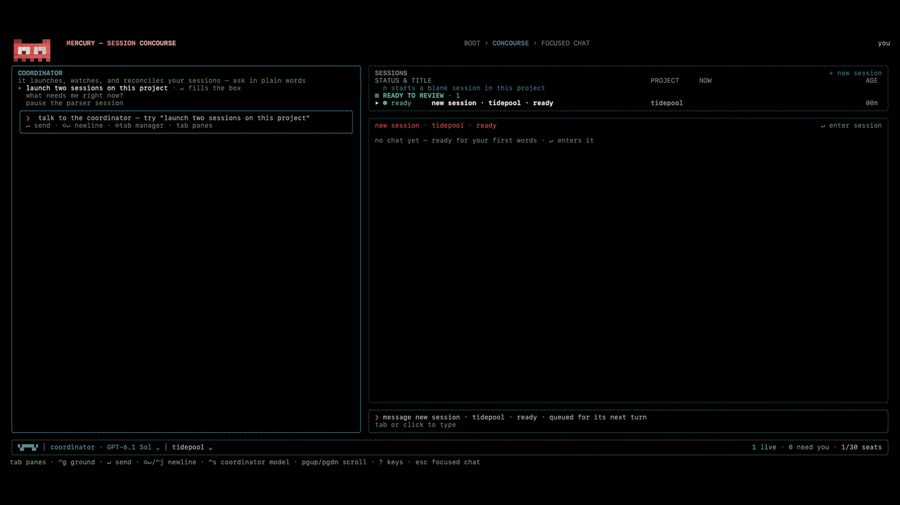

# Mercury CLI

Mercury CLI (mercury-cli.ai, npm package `mercury-tech-cli`) runs AI coding agents in your terminal, inside your own git repositories on macOS, Linux and Windows.

Website: [mercury-cli.ai](https://mercury-cli.ai) · Repository: [github.com/Whq02/MercuryCLI](https://github.com/Whq02/MercuryCLI) (`Whq02/MercuryCLI`) · npm: `mercury-tech-cli`

An agent reads and edits files, runs shell commands, steps through tests and debuggers, and checks the results. You choose the model provider, the model, and what the agent is allowed to do:

- **Multi-session Concourse and isolated worktrees:** run multiple sessions side by side on the Session Concourse (`/concourse`), and delegate parallel work to cross-provider crewmates (`Crewmate`) in isolated `git worktree` checkouts with project file leases so parallel agents do not overwrite each other.
- **20 model providers and `/localsetup`:** keep all 20 providers signed in at once (OpenAI, Anthropic, Google Gemini, DeepSeek, Moonshot/Kimi, Z.AI/GLM, OpenRouter, Hugging Face, xAI/Grok, Meta/Muse, Mistral, Nous Portal, OpenCode Zen, Qwen, MiniMax, Together AI, Cohere, Groq, Cerebras, Fireworks AI), switch providers and models mid-chat, or run `/localsetup` for one-command local model setup with Ollama alongside LM Studio, vLLM and llama.cpp.
- **Mneme hybrid RAG project memory:** combines an on-device 118 MB BGE semantic embedding model (`bge-base-en-v1.5`) with BM25 word ranking and citation tracking, verbatim pinned rules, branch-aware startup context, write-time contradiction checks, session handoff notes, and the `/memory page` browser graph.
- **Compiler, AST and DAP debugging tools:** wires in LSP code intelligence and previewed refactors (`LspRead`, `LspRename`, `LspMoveSymbol`, `LspMoveFile`, `LspCodeAction`, `LspFormat`), 23-language tree-sitter AST structural search and rewrites (`AstSearch`, `AstEdit`), a built-in Debug Adapter Protocol (`Debug`) debugger (`debugpy`, `js-debug`, `lldb`, `gdb`, `dlv`) that failing Python, Node, Go and Rust tests step straight into, and persistent Python and JavaScript `Eval` cells.
- **Keyless `WebSearch` and markdown `WebFetch`:** searches through provider-native search, Brave or Tavily keys, official APIs (Stack Exchange, npm, PyPI, crates.io, GitHub, Hacker News, Wikipedia), SearXNG and keyless DuckDuckGo, and fetches public documentation as clean markdown within a 38,000-character call budget.
- **Desktop computer use, Whisper voice, Saturn scheduling and editor bridges:** drives desktop applications (`Computer`), transcribes push-to-talk voice dictation on-device with Whisper (`/voice`), schedules recurring or one-shot sessions with Saturn (`/saturn`), and connects to VS Code over the Agent Client Protocol (`mercury acp`) as well as Unity, Blender, Godot and Aseprite.

I use Mercury to build Mercury, running multiple sessions and models across long tasks. Keeping track of that work is the hard part: what is still running, what changed, and what needs a decision. Each session writes its own handoff note when it finishes, and the next session reads that note once at startup alongside my pinned rules, stopping context poisoning between sessions.



Mercury is source-available. See [Licence](#licence) for the production-use terms.

## Install

Release archives are available for Apple silicon and Intel Macs, Linux x64
and arm64, and Windows x64 and arm64. Install `git` separately; each archive
includes Node and ripgrep, so a separate Node installation is unnecessary.

Choose one installation method:

```sh
curl -fsSL https://mercury-cli.ai/install | sh     # macOS and Linux (x64 and arm64)
irm https://mercury-cli.ai/install.ps1 | iex        # Windows (x64 and arm64), in PowerShell 7
brew install Whq02/mercury/mercury                 # Homebrew: macOS and Linux x64
npm install -g mercury-tech-cli                    # npm; `bun install -g mercury-tech-cli` is the same package
mise use -g npm:mercury-tech-cli                   # mise, through the npm package
```

The install addresses keep approximate script-request counts by source and UTC
day (completed installs are not counted); the counter stores no IP address, user-agent string
or cookie.

Open a new terminal, or run the `export PATH=…` line the shell installer
prints, then run `mercury --version` to check it and `mercury` from a
repository to start the [first run](#the-first-run). On Windows PowerShell, and
after a Homebrew, npm, bun or mise install, `mercury` works in the same
terminal.

<details>
<summary>Installation paths, updates and release verification</summary>

### How the installation methods differ

The shell and PowerShell installers fetch the newest release for your
platform, check its SHA-256 against `SHA256SUMS.txt`, unpack it, and run the
archive's own `mercury install` command.

Homebrew and the npm package are each pinned to a particular release and are
republished after a tag, so they can lag behind the newest release. Homebrew
commands use the full tap name `Whq02/mercury/mercury` (bare `mercury` in
`homebrew-core` is a different program). The npm package, `mercury-tech-cli`,
is a launcher that downloads its pinned release; mise installs that same
package. To remove the installed release and command shim while keeping your
configuration and sessions, run `mercury install --uninstall` (and `npm
uninstall -g mercury-tech-cli` if you installed the npm launcher).

Mercury's installation is user-local and does not require administrator
access. You can safely rerun an installation command.

### Installation paths

Release versions live under the config home at `~/.mercury/versions/<version>`
(`%USERPROFILE%\.mercury\versions` on Windows). The `mercury` command is
installed in `~/.local/bin` on macOS and Linux, or
`%LOCALAPPDATA%\Mercury\bin` on Windows.

`mercury install` adds the command's directory to PATH once: a guarded line
in your shell startup file, or an entry in the Windows user PATH. A new
terminal picks up the change automatically.

### Updates

Use `mercury update` with any installation method.

For an installation made with the shell or PowerShell installer, or with
`mercury install`, it updates Mercury in place. `--check` checks for updates,
`--status` reports update status, and `--rollback` returns to the previous
version, which stays on disk.

For Homebrew, it asks before running `brew upgrade Whq02/mercury/mercury`.
The default answer is no; enter `y` to approve. Mercury streams the command's
output and checks the installed version afterwards. Use `--yes` to skip the
prompt in scripts.

The npm launcher uses the same release layout as the installers and delegates
each run to the installed release. `mercury update` therefore updates an npm
installation in place through Mercury's own update channel.
`npm update -g mercury-tech-cli` changes only the release the package installs
on its first run. This also applies when using mise.

`--check` reads the same release list for every installation method and tells
you how to update yours. When an update is available, the home screen shows
`vX.Y.Z available · mercury update` once in its bottom-right corner, and the
chat shows a temporary notice. Set `MERCURY_UPDATE_NOTICE=0` to hide both.

Install and update requests fetch the public release list and archives
anonymously. You can run them without an account or token. If an anonymous
request is refused, Mercury consults a signed-in GitHub CLI (`gh`).

After an update, Mercury checks whether the command on your PATH points to
the updated installation. If another installation takes precedence, or the
updated command is missing from PATH, it explains the problem and the fix.
`mercury health` reports the same issue.

### Release verification

Before activating a release, Mercury checks its archive against
`SHA256SUMS.txt`. It also requires a payload signed by the Mercury release
key in its compiled-in trust roster before staging the update. A rejected
signature leaves the active installation unchanged.

Use `--allow-unsigned` to accept an unsigned payload. Mercury still rejects
unknown signing keys, malformed signing blocks and tampered contents. The
command result and its local record both show that you allowed an unsigned
payload.

From 1.0.0-beta.3, archives are signed during packaging and their signatures
are verified before publication. A verified installation adds no signature
notice at startup. `mercury health` reports the signing key `627b54b734ca0e72`.

The 1.0.0-beta.2 archives are unsigned. These installations report
unsigned provenance once per install when you start Mercury interactively
without a command or flag. The health check continues to show that status. It means
the archive manifest has no signature; the download is still checked against
`SHA256SUMS.txt`.

[docs/TRUST.md](docs/TRUST.md) explains the verification results and how to
check an archive manually.
[docs/TERMINAL-RUNTIME.md](docs/TERMINAL-RUNTIME.md) covers startup verification.

### Platform notes

Release archives exist for every platform listed above. Any other machine
builds from source.

Intel Mac archives are available from 1.0.0-beta.3. They are cross-packaged on
an Apple silicon runner and tested at startup under Rosetta before
publication. Intel Macs using 1.0.0-beta.2 need a source build.

</details>

## Requirements

Release archives include Node 24 LTS. The launcher, `mercury install` and
`mercury update` use that bundled runtime; `git` is the only separate
requirement for the release itself.

To build from source, you need:

- **Node 24 LTS**, in the supported range `>=24.20.0 <25`. `.node-version`
  pins the patch used for builds and included in release archives.
- **bun 1.3.x** for the build. It is not bundled with releases.
- **git**. On Windows, run PowerShell 7 inside Windows Terminal or the
  VS Code terminal. See
  [docs/INSTALL-WINDOWS-FROM-SOURCE.md](docs/INSTALL-WINDOWS-FROM-SOURCE.md).

The Node minimum includes the fix for nodejs/node#56645. Below 24.20.0,
headless `run` commands that call a tool abort on exit on Windows.

Launchers select Node in this order: the explicit `MERCURY_NODE` binary, the
bundled runtime, then a compatible Node installation on PATH. If the runtime
is missing, the launcher reports an error.

### Windows shells

Release archives include Mercury's bash-compatible shell engine (`brush`),
and on Windows it serves the Bash tool by default: it finds a `.cmd` or
`.bat` program such as `npm` by its bare name through PATHEXT, passes `%VAR%`
and `^` to a batch file unchanged, runs a program named by a relative path
after `cd`, and keeps shell state between calls. Git for Windows' `bash.exe`
is not required; when it is installed, `MERCURY_SHELL_ENGINE=system` or
`system` in `/config` under Shell engine runs the Bash tool on `bash.exe`
alone.

Read the health check's `shell` row to see which shell is active and why: the
bundled engine (the Windows default, or armed by the pin or the setting), or
Git Bash when the engine was turned off or its pack is absent.

On macOS and Linux the system shell is the default; set
`MERCURY_SHELL_ENGINE=brush`, or choose `brush` in `/config` under Shell
engine, to run the Bash tool on the bundled engine there too, with persistent
shell state.

A source build without the engine pack or Git for Windows still starts, but
the Bash tool is unavailable. The PowerShell tool remains available, and the
`shell` diagnostic explains how to restore Bash support.

## Build from source

Mercury builds with bun and runs on Node 24 LTS. Install [the source-build requirements](#requirements), including bun 1.3.x:

```sh
curl -fsSL https://bun.sh/install | bash           # macOS and Linux
powershell -c "irm bun.sh/install.ps1 | iex"       # Windows, in PowerShell 7
bun --version                                      # 1.3.x
```

Then, in a clone of this repository:

```sh
bun run setup                      # once; bun install + the vendored packs
bun run build.ts                   # writes dist/mercury.mjs + dist/manifest.json
node dist/mercury.mjs --version
node dist/mercury.mjs
node dist/mercury.mjs health --json
```

### Terminal support

The full-screen interface needs a real TTY, but has no minimum terminal size.
The full layout starts at 100 columns by 26 rows; smaller windows use a
compact layout.

Mercury uses 24-bit colour when the terminal advertises support through
`COLORTERM=truecolor` or is recognised as iTerm2, Ghostty, WezTerm, Kitty,
Windows Terminal or VS Code. Other terminals use 256 colours, including
Apple's Terminal on macOS 15 and earlier.

The health check's Terminal color row reports the detected depth and the reason.
Set `MERCURY_TRUECOLOR=1` for a terminal that supports true colour but does not
advertise it, or `MERCURY_TRUECOLOR=0` to force 256 colours.

### Optional components

`setup` fetches the bundled capability packs: pyright, debugpy, js-debug,
extra grammars, the platform's Node runtime, and brush. If a download fails,
that pack is skipped and the build and affected tools report the missing
component. Running `bun install` alone produces a build without those packs.

To build voice support, run `setup` with Rust installed. That builds
`native/voice`. Add cmake to build `native/whisper` as well. With Rust
installed, `setup` also builds the desktop driver addon (`native/desktop`) that
the `Computer` tool runs through. With Rust installed,
`setup` also builds the local embedding addon (`native/embed`,
`bun run scripts/vendor/build-embed.ts`) and fetches the 118 MB BGE model
(`bun run scripts/vendor/fetch-embed-models.ts --default`); without cargo the
pack is skipped, setup says so, and Mneme memory lookup runs word match only.
Every release archive carries the embedding pack built for its platform;
on Linux and Windows the maths runs a
vectorised kernel, so a Recall by meaning takes about a tenth of a second (a
few hundredths on macOS, which uses Accelerate). If a native build
lacks its tools, setup skips it and the health check reports the missing
addon. The Windows shell engine is compiled on your machine too because
upstream has no Windows binary.

See [Windows shells](#windows-shells) and
[docs/TERMINAL-RUNTIME.md](docs/TERMINAL-RUNTIME.md) for the `brush` shell
engine.

The build writes only to `dist/`. Configuration and sessions live in
`~/.mercury`, or the directory set by `MERCURY_CONFIG_DIR`, and are created on
first run. On Windows, run `node dist\mercury.mjs` directly.

### Installing a source build as a command

`scripts/ops/deploy-runtime.sh` publishes a clean-tree build to a fresh
`<config home>/runtime/builds/<build>` folder and points `runtime/current` at it
(`runtime/dist` is the older name for the same link). `scripts/ops/deploy-launcher.sh`
installs the launcher at `<config home>/bin/mercury`. Add that directory to PATH; for zsh:

```sh
echo 'export PATH="$HOME/.mercury/bin:$PATH"' >> ~/.zshrc
```

The launcher stops with an error if the runtime is missing. It does not
switch to another build. Node selection follows the order in
[Requirements](#requirements). For a release installation, run `mercury
install` or `mercury update`, which leave source checkouts unchanged; see
[Updates](#updates).

[AGENTS.md](AGENTS.md) is the short build-and-run guide.
[BUILD-NOTES.md](BUILD-NOTES.md) covers the build in more detail.

## The first run

On your first interactive run, choose an appearance, then sign in to a
provider. The screen previews theme changes as you browse. True Black is
the default; the other options are the oasis dark theme and Black and
white, which paints no colour at all: the terminal's own ink on its own
ground, the way Mercury looks on a terminal without colour. You can change
this later with `/appearance`.

You can also choose "sign in later" to look around without connecting an
account. When a provider key in your environment already signs a provider
in, the sign-in step is not asked. Next, the Guardrails step reminds you to
check Mercury's edits and commands, and that what it reads can carry
instructions for the model. In a terminal
Mercury knows how to configure (Terminal.app, the VS Code family, Alacritty,
Zed), a Terminal keys step can configure newline keybindings in the
terminal's own settings (on macOS Terminal.app, it sets `Option+Enter` for a
newline and silences the terminal bell across every profile, which takes
effect after restarting Terminal.app; in the VS Code family, Alacritty and
Zed, it writes `Shift+Enter` for a newline). It is off unless you choose it,
and a backup is kept.

Next, Mercury asks whether you trust the folder you opened. Nothing requested
by a workspace configuration runs before you grant that trust. The grant
covers the whole repository; declining exits Mercury. See
[docs/TRUST.md](docs/TRUST.md).

A normal interactive launch opens the home screen.
It has ten menu entries, with Continue Last Session appearing only after you
have session history:

- **New Session in \<folder\>** starts a new session in the current folder.
- **Continue Last Session** returns to your most recent chat.
- **Boot Menu** configures future sessions, including motion, crewmates
  and workflows.
- **MCPs & Skills** chooses what the next session loads. See
  [docs/KIT.md](docs/KIT.md).
- **Agents** creates and edits agents.
- **Health Check** checks the installation.
- **Saturn Scheduler** schedules sessions. See
  [docs/SATURN.md](docs/SATURN.md).
- **Logins** connects provider accounts.
- **Session Concourse** opens the current project’s session list.
- **Sessions · Projects** lets you choose a session or repository.

Menu entries open over the home screen, and `Esc` returns to the entry you
selected. The session list opens on a separate screen, also available with
`Shift+→`. A prompt argument, `--continue` or `--resume` takes you directly
to the chat.

### Motion, crewmates and workflows

The Boot Menu's Performance section includes a Motion setting:
`auto`, `full`, `reduced` or `off`. It controls idle animation in the
interface and is also available in `/config`.

Under Agents, the Crewmates and Workflows switches determine whether new
sessions receive the Crewmate and Workflow tools. Turning a switch off removes
the corresponding tool; attempts to spawn that type of work return the same
explanation. Within a session, `/crewmates on|off` and `/workflows on|off`
change the setting at the next turn boundary.

## The daily loop: Session Concourse, git worktrees and crewmates

### Starting a session and isolating worktrees

Press `Enter` on New Session to create a session in the current folder with
your default model. Mercury opens its chat and adds it to the session
list at the same time. It keeps a process ready behind the menu to reduce
startup work.

Starting another session does not stop the previous one. You can leave a
task running and work elsewhere. Launch with `--worktree [name]` (or ask for a
`worktree` in chat to run `EnterWorktree`) to give a session its own branch and
checkout under `.mercury/worktrees/`. Parallel crewmates can also run in
isolated worktrees and coordinate shared files with project file leases; see
[What is inside](#what-is-inside-mneme-rag-memory-lsp-23-language-ast-dap-debugger-web-search-and-bridges) and [docs/CREW.md](docs/CREW.md).

### Working in chat

Describe the work in plain language. The agent reads, edits, runs and checks
code under your chosen permission mode. Tool calls appear as they run, either
as compact cards or with full output. Choose the display in `/config` under
Tool output; the setting is saved for later launches.

Use `/model` and `/effort` to adjust the session. `/permissions` controls what
can run without approval and what must ask first.

Review changes with `/diff`, by source, file and hunk. `! <command>` runs a
shell command in the chat and streams a live output tail while it runs. `/runs`
shows running shells and crewmates (`/tasks` still opens the same board), and
`/crewmates` opens the live Crew view. When no turn is running, `/clear` saves
the current chat for later and opens a fresh session; `/restart` moves the chat
onto a newly installed Mercury build; `/title` names the chat, and `/help`
lists the available commands.

### Moving between screens

`Shift+←` and `Shift+→` move between the screens currently available. A fresh
launch has the home screen and session list. The chat screen is added when
a session is focused and removed when the last chat closes. The key hints
show only the available moves.

Closing every chat returns you to the home screen. Use `--chat` for just the
home screen and chat, without the session list. `--concourse-off` saves that
preference for future launches; `--concourse-on` or `/config` turns it back on.

### Managing sessions on the Session Concourse

Open the session list with `/concourse` or `Shift+→` from the home screen.
It shows the current project’s running sessions first, followed by saved
chats that are not running, newest first.

Each running session has a NOW cell showing its current activity. Select a
row and press `Enter` to return to the chat while the other sessions keep
running. A crashed session stays on the session list as NEEDS YOU, with the
reason, until you release it.

[docs/SESSIONS.md](docs/SESSIONS.md) covers the session lifecycle.

## Providers and models: sign-ins, `/localsetup` and `/llmhost`

Use `/logins` to connect a provider. It opens the same sign-in catalogue used
during setup. `/accounts` manages connected provider slots afterwards.

- **OpenAI:** ChatGPT subscription or API key.
- **Anthropic:** Claude subscription, Console sign-in or API key.
- **OpenRouter:** catalogue access through OAuth or an API key; model requests deny data collection and require every parameter from the start. `/config → OpenRouter routing policy` sets fallback and zero-data-retention choices; choose open to relax the policy and leave routing to OpenRouter.
- **Google Gemini:** Sign in with Google, an API key, or your own OAuth client. Sign in with Google runs Gemini on the quota of the plan the Google account holds (a free account, Google AI Pro or Google AI Ultra) through Google's own Antigravity client: the prompt, the tool schemas and the tool results go to Google's Code Assist endpoint under that client and the signed-in account, and `/model` lists the roster Google serves the account. An API key or your own OAuth client bills a Cloud project instead.
- **Hugging Face:** device-code sign-in or Hub token.
- **Kimi (Moonshot):** device-code sign-in or API key.
- **GLM (Z.AI):** API key.
- **DeepSeek:** API key.
- **xAI (Grok):** sign in with your Grok subscription (SuperGrok / X Premium) or paste an API key through `/logins xai`.
- **Meta (Muse):** Sign in with Meta (a Muse Code subscription, a device code in your browser) or a pay-as-you-go Model API key. Sign in with Meta exchanges the device code against Meta's OIDC endpoints (`https://auth.meta.com/oidc/device/authorization/` and `/oidc/device/token/`) under Muse Code's public client id, sends the resulting account token once to `https://api.meta.ai/muse-code/key` to mint the subscription's API key (and on bounded `/usage` reads for the plan's tier and usage windows), and sends only the minted key on every model request to `https://api.meta.ai/v1`. A pasted Model API key or `MODEL_API_KEY` / `META_API_KEY` bills pay-as-you-go.

- **Qwen:** a QwenCloud key (Token Plan or pay-as-you-go) or an Alibaba Cloud
  Model Studio key (pay-as-you-go, Token Plan or Coding Plan), checked on its
  own endpoint before it is stored; a plan key lists the plan's models, Qwen3.8
  Max first.
- **MiniMax:** an Open Platform key or an M Plan subscription key.
- **Together AI** and **Cohere:** API key.
- **Groq**, **Cerebras** and **Fireworks AI:** API key; any family's key can
  also come from a command named in `credentials.keyCommands.<family>`.

Mistral, Nous Portal and OpenCode Zen connect through `/logins` as well, giving
20 sign-in provider families in all. Local model servers (Ollama, LM Studio,
vLLM and llama.cpp) and custom OpenAI-compatible endpoints are discovered or
configured without a provider sign-in; run `/localsetup` to install or start
Ollama, pull a model sized to your machine's memory, set its context window,
or connect a running LM Studio, vLLM or llama.cpp server
([docs/LOCAL-SETUP.md](docs/LOCAL-SETUP.md)). Each provider has its own
protocol, credentials and error handling. A request does not fall back from
one provider to another. See [docs/ENGINES.md](docs/ENGINES.md).

Open `/llmhost` to choose a model and see where it can run right now: on a GPU
rented from Runpod, Vast.ai or Lambda, on your own computer or a saved SSH
computer (`mercury host`), or on a model server already running. Each model page
shows quality variants, the GPU-memory budget split across parallel
conversations (`conversations × context`), and the default thinking level
(adjustable per request with `/effort`). Renting requires an explicit
hourly-price confirmation, supports pre-rental or in-place `Tune` on Runpod,
fast-load weights volumes and 5-second stock watches on Runpod, and continues
setup in the background after the popup closes. Vast.ai and Lambda rentals are
new in 1.0.0-beta.40 and verified against the vendors' published APIs on
fixtures (live rental runs were not performed). [docs/LLM-HOST.md](docs/LLM-HOST.md)
walks through every hosting option.

New sessions use your most recently connected provider and the newest model
available to that account. Models the account cannot access are skipped.
If that provider has no usable model, Mercury checks the next most recently
connected provider. This choice happens when the session starts; a failed
request in an existing session stays with its provider.

`/model` explains the selection. A family word picks that family's newest
model: `/model grok`, `/model deepseek`, `/model kimi` or `/model glm`. With
no provider connected, the home screen and `/model` direct you to `/logins`.
`/defaultprovider` lets you explicitly make a provider the most recent
choice.

Provider access remains subject to the provider's own terms and availability.
Mercury's licence does not replace them.

## The headless CLI: `mercury run`, Docker and JSON-RPC runner

The same build runs without the interactive interface.
`node dist/mercury.mjs --help` lists every flag.

`mercury run "<prompt>"` runs a prompt without a terminal UI:

```sh
mercury run "Summarise this repository." --format text
mercury run "Summarise this repository." --format json
mercury run "Summarise this repository." --format rows
```

- `text` prints the answer; a failed turn's reason goes to stderr.
- `json` prints the last `outcome` row as one JSON object.
- `rows` writes one JSON object per line: `session`, then a `turn` and its
  `text`, `reasoning`, `tool_call`, `tool_result` and `step` rows, ending in
  `outcome`. Waits, tool progress, background tasks and notices have their
  own rows. Every row carries `seq`, `timestamp` and `session_id`; rows
  within a turn also carry its `turn` number. `seq` numbers this run's
  stream from 1; `turn` counts the session's turns, so a run that continues
  a stored conversation (`-c`, `-r`, `--fork`) numbers its turn after the
  turns already in it, and its `session` row names the conversation it
  continues in `resume_of`.

The output row types, by their `type` field:

- `session`: the opening row: `version`, `build` (the first twelve hex
  characters of the tree the bundle was built from, as `mercury daemon
  status` prints it; absent when no manifest sits beside the bundle),
  `resume_of` (on a continued run, the session id of the conversation it
  continues; the same id as `session_id` unless the run was forked), `cwd`,
  `model`, `mode`, the `tools`, `mcp_servers`, `commands`, `agents`,
  `skills` and `extensions` the session has, and `tools_withheld` (present
  when a deny rule withholds a tool by its bare name: each entry's `tool`,
  `rule` and `source`).
- `turn`: a turn `started` or `waiting`, with its `turn_id`; `model`,
  `message_ids` and the `agents` count when known.
- `text`: a settled text block: `message_id`, `block`, `text`, and its
  `phase` (`commentary` or `final_answer`).
- `reasoning`: a settled reasoning block: `message_id`, `block`, `text`, or
  `redacted: true`.
- `tool_call`: a tool call: `call_id`, `tool`, `input`, with its
  `message_id` and `block`.
- `tool_result`: the call's result: `call_id`, `status` (`ok`, `error`,
  `aborted` or `refused`) and `output`. A call the model shaped so badly that
  it was refused before execution (an unknown tool, arguments that are not
  valid JSON or do not fit the tool's schema) still gets its pair: a
  `tool_call` row with the arguments as delivered (`{}` when they were not an
  object) and a `tool_result` row with status `refused` whose `output` is the
  reason; the correction `notice` follows. Such a call never ran and is not a
  denial.
- `tool_update`: progress from a running tool: `call_id`, `tick`, `source`
  (`shell`, `powershell`, `mcp` or `eval`), and whichever of `line`,
  `elapsed_s`, `lines`, `bytes`, `budget_ms`, `progress` and `total` the call
  reports. A shell or PowerShell call ticks as its output arrives (a command
  that prints nothing never ticks), an MCP call when its server reports
  progress, an Eval call while its cell runs; no other tool ticks; a Browser
  or Crewmate call is silent until its result.
- `step`: one model call of the main thread: `message_id`, `model`, `usage`,
  and `stop` when the model said why it stopped.
- `outcome`: the turn's result, described below.
- `close`: the note left for the next session at close: `state` (`stored`,
  `skipped` or `none`), `note_chars`, and the `usage` of the model calls that
  wrote it, so a reader summing every row's usage reaches the outcome's. With
  the prompt given as an argument the note is asked inside the last turn and
  `close` precedes that turn's `outcome`; with `--input rows` it follows the
  last `outcome` once stdin closes.
- `wait`: a wait on the model: `state` (`first_byte`, `retry`, `silence`,
  `loading` or `done`) with the figures that state carries, such as
  `since_ms`, `attempt` and `of`, `delay_ms`, `reason` and `http_status`.
- `heartbeat`: the model stream showed life after at least a second without
  a parsed event: bytes arrived that produced no row. The row carries nothing
  else and comes at most once a second; how often depends on the provider's
  streaming shape, so a stream that never pauses between events emits none.
- `compaction`: a compaction `started`, in `progress` or `ended`: `trigger`
  (`manual`, `auto` or `overflow`), `stage`, `fill`, `summary_tokens` and, at
  the end, `exit` (`landed`, `cancelled` or `failed`).
- `mode`: the permission mode changed: `mode`.
- `rate_limit`: the provider's limit state: `status` (`allowed`, `warning` or
  `rejected`), `window`, `resets_at`, `utilization` and the overage fields.
- `task`: a background task `started`, in `progress` or `ended`: `task_id`,
  `task_type`, `description`, `usage`, `summary`, `status` (`completed`,
  `failed` or `stopped`) and `output_file` as they become known.
- `notice`: a `warning` or `error` for the reader: `text`, and a `code` such
  as `input_refused`.
- `command_output`: the output of a slash command that never reached the
  model: `command` and `text`.
- `mission_updated`: the session's task ledger changed; read it again.
- `samples_updated`: the session's samples changed; read them again.

`--partial` with `--format rows` adds `block_start`, `text_delta`,
`reasoning_delta`, `tool_input_delta` and `retracted` rows. Deltas belong to
`message_id` and `block`; a `retracted` row withdraws that message's deltas.
The settled text or tool row is the complete value.

The outcome carries `schema`, `turn_id`, `status`, `steps`, `wall_ms`,
`usage`, `models` and `denials`, with `answer` on completion and `error`
(`message`, `class`, optional `detail`) on failure. `stop`, `api_ms`,
`cost_usd`, requested `structured` output and `notices` are included when
available. `wall_ms` is the turn's elapsed time. `api_ms` is the sum of the
durations of every model request the turn made (including retries and the
crewmates' requests that ran alongside the main thread), so it
can exceed `wall_ms` when requests overlapped. `cost_usd` is the USD of the turn's priced
requests, whatever the status: a request Mercury cannot price (no rate on
file, no cost stated in the response) adds nothing to it and leaves its model
listed in `models` without a `cost_usd` of its own; the field is absent only
when nothing in the turn was priced. On a Claude subscription sign-in the
Anthropic requests have no dollar price, so neither they nor the row carry a
`cost_usd`; the usage stays. Usage names `input_tokens` (cached tokens included),
`cached_input_tokens`, `cache_write_input_tokens`, `output_tokens` and,
when reported, `reasoning_output_tokens`, summed over the main thread and
the crewmates. `models` breaks token usage down by model. `steps` counts only
the main agent's model calls; model calls made by crewmates appear as their own
`step` rows tagged with `parent_call_id`.

The status is `completed`, `blocked`, `refused`, `failed`, `interrupted`,
`turn_limit`, `budget_limit`, `time_limit`, `schema_unmet` or `loop_stopped`.
A run under `--max-time` (seconds, or `10m`, `1h`) ends `time_limit` at the
next step once the time is up; the model call or tool round under way is not
cut. A completed run exits 0, other outcomes exit 1, and a usage error exits
2. SIGINT and
SIGTERM exit 130 and 143 after the interrupted turn's outcome is flushed. A
refused tool call is listed in `denials`. When the refusal was an ask nobody
could answer (a run with no host in a mode that asks, `--mode dontAsk`, or a
host's ask that expired) and no later tool call in the turn succeeds, the run
is `blocked`: the answer is kept, `error` names the tool and how to resume
(`--allowed-tools`, another `--mode`, or a host that answers asks), and the run
exits 1. If a later tool call in the same turn succeeds, the turn recovers and
finishes `completed` (exit 0) with a warning `notice` (`"<Tool> was not
approved; the run continued with other tools."`). A refusal you did
answer (through a deny rule, a hook, or a host that said no) leaves a completed turn
completed. A question to the operator (`AskUserQuestion`) that nobody could
answer is `blocked` the same way, with the question itself quoted in `error`;
the outcome is read from the run's own asks, never from the words of the
answer, so a question written only in the answer reads as `completed`. An unknown slash
command is `refused` with the same sentence the interactive screen gives (`Unknown
command: /name · /help lists commands`) and exits 1.

`--input rows` requires `--format rows` and reads one input object per line:

```sh
printf '%s\n' '{"type":"prompt","content":"Summarise this repository."}' | mercury run --input rows --format rows
```

The input types are `prompt` with `content` (text or text/image blocks),
`shell` with `command`, and `note` with `to` (an agent id) and `content`.
Each accepts an optional `id`; prompt and shell rows also accept `priority`
(`now`, `next` or `later`), `sent_at` and `origin`. A rejected input shape
produces a `notice` with code `input_refused`; malformed JSON ends the run.
These rows carry input only; permission answers use the runner protocol below.

Use `mercury run -` or pipe text into `mercury run` to read the whole prompt
from stdin. Beside a prompt argument, piped text is appended as delimited
context: the pipe is read until it closes or has been silent for one second,
so a stream that keeps delivering is read to its end and a pipe that stays
open and silent does not hold the run. With no prompt and a terminal on
stdin, `run` prints its usage and exits 2.

`--mode <mode>` selects the permission posture. `--sovereign` runs without
permission prompts, and `--allow-sovereign` makes that posture available for
a later switch. Permission policy and deny rules still apply. A root user
entering sovereign mode gets one notice on stderr; the run continues.

Use `-c` to continue the most recent conversation, `-r` to resume by ID, title
or picker, `-w` to run in a managed worktree, and `--lean` for a minimal session.
A `run` has no host to answer permission asks: its permission rules and mode
decide what can run, and a call that still needs approval is denied.

### The headless image

The `Dockerfile` at the repository root builds a Linux x64 image for CI and
servers. Its entry point is `mercury` and its default verb is `run`, so the
image runs one prompt against a mounted tree and exits with the run's code:

```sh
docker build -t mercury .
docker run --rm -e ANTHROPIC_API_KEY="$ANTHROPIC_API_KEY" -v "$PWD":/work mercury run "Summarise this repository." --format text
docker run --rm mercury --version
```

The image carries the bundle, its Node 24 runtime (on `PATH`), the vendored
search, shell, debugger, language and image tools, `git` and the certificate
store; no enter screen and no sign-in flow. It runs as the non-root user
`mercury` with its config home inside the container (`MERCURY_CONFIG_DIR`),
and `/work` is its working directory. Colour and mouse follow the product's
own terminal detection, and `--user 0` runs as root with the one sovereign
notice above.

A provider key arrives as an environment variable, the same spellings the
product reads everywhere: `ANTHROPIC_API_KEY` or `ANTHROPIC_AUTH_TOKEN`,
`OPENAI_API_KEY`, `GEMINI_API_KEY` or `GOOGLE_API_KEY`, `XAI_API_KEY` (and
`XAI_MANAGEMENT_API_KEY` for its usage meter), `DEEPSEEK_API_KEY`,
`MOONSHOT_API_KEY`, `ZAI_API_KEY`, `OPENROUTER_API_KEY`, `HF_TOKEN`,
`MISTRAL_API_KEY` (and `MISTRAL_ADMIN_API_KEY` for its organisation meter),
`NOUS_API_KEY`, `OPENCODE_API_KEY`, `MINIMAX_API_KEY`,
`TOGETHER_API_KEY` or `TOGETHER_AI_API_KEY`, `COHERE_API_KEY` or `CO_API_KEY`,
`GROQ_API_KEY`, `CEREBRAS_API_KEY`, `FIREWORKS_API_KEY`, `DASHSCOPE_API_KEY`,
`MODEL_API_KEY` or `META_API_KEY`, `MERCURY_COMPAT_API_KEY` for a custom
OpenAI-compatible endpoint and `MERCURY_LOCAL_API_KEY` for a local server.
With no key the run refuses in one line and exits 1. `docker run -i … mercury
run -` reads the prompt from stdin.

### Hosting a session

`mercury runner` serves a session to a host over stdio: JSON-RPC 2.0, one
message per line. The host sends `initialize` first and waits for the answer
before sending work:

```json
{"jsonrpc":"2.0","id":1,"method":"initialize","params":{"protocol":1,"host":{"name":"my-host","version":"1.0.0"},"capabilities":{"holds_asks":true,"elicitation":false,"partial_rows":false}}}
```

The host's name and version travel under `host`; `capabilities` declares
`holds_asks`, `elicitation` and `partial_rows`. Every request `id` is a
positive integer: a request whose `id` is anything else is answered `-32600`
with `id: null`, so number requests from 1.

`queue/add` takes the same prompt, shell or note object as the row input
above. Output arrives in `row` notifications. `session/facts` reads the
session's state; `session/set_mode` changes the permission mode at once;
`session/set_model` and `session/set_effort` change the model and the effort,
and a change made while a turn runs is held until the turn ends: it answers
with `at: "turn_end"`, then `session/applied` announces it.
`turn/interrupt` stops a turn; close stdin to end the session.

Permission asks arrive as `permission/request`, with `kind: "tool"` or
`kind: "network"`. The host answers with `outcome: "allow"` or
`outcome: "deny"`; an allow may carry edited `input` and permission `rules`.
A withdrawn ask sends `$/cancel_request` with its `request_id`.
`holds_asks` gives the host ownership of the ask's clock. An MCP question
uses `elicitation/request` only when the host declares `elicitation`;
otherwise it is answered `cancel`.

An unknown method answers `-32601`, invalid parameters `-32602`, an `id` that
is not a positive integer `-32600`, and a request before initialization
`-32002`. A rule refusal is `-32010`, with a
sentence in `error.message` and a reason in `error.data.kind`, such as
`mode`, `model`, `effort` or `claim`. The runner answers a malformed line
with `-32700` and continues; three consecutive malformed lines end it.

### Other commands

Available commands include:

- **`mercury health`**: diagnostic report, also called the
  health certificate. `--json` returns the full report, `--deep` runs the deep
  inventory, and `--fix` runs guided fixes.
- **`mercury auth login [<family>]|list|status [<family>]|logout [<family>]|mint`**:
  sign in (`login [<family>]`), list provider families (`list`), check whether
  an account is signed in (`status [<family>]`), sign out (`logout [<family>]`),
  or mint a long-lived Anthropic token (`mint`).
- **`mercury models [--json]`**: print the models the signed-in accounts reach
  (the same facts as `mercury://models`).
- **`mercury mcp`**: manage MCP servers with `add`, `import`, `list`, `get`,
  `remove`, `trust-reset` and `serve`.
- **`mercury extensions`**: install extensions and manage their sources.
  Actions: `list`, `sources`, `add`, `remove`, `refresh`, `install`, `trust`,
  `enable`, `disable`, `update`, `uninstall`, `fence`, `unfence`, `inspect`
  and `scaffold`.
- **`mercury roster`**: list the agent inventory.
- **`mercury usage`**: print the compact figures line the `/usage` screen
  shows; `--json` prints the whole reading: each signed-in provider's windows
  with used and reset, the figures and credits it stated, each with its source
  and age, and the session spend per model, read the way the screen reads it
  (each signed-in provider's reader sampled once, as on open).
- **`mercury daemon run|status|stop|restart`**: run, inspect, stop or restart
  the background daemon. Its session seats are `mercury runner` children; the
  daemon sends their prompts and hosts their permission asks.
- **`mercury sessions list`** (also a bare `mercury sessions`): list this
  project's saved sessions, newest first: the id, when it was last written,
  its size, `live` when the daemon hosts it now, and its title or first
  prompt; `--all` reads every project, `--limit <n>` bounds the list. The id
  is what `mercury --resume <id>` reopens and `sessions delete` removes.
- **`mercury sessions delete <id>`**: delete one saved session on purpose —
  its transcript and the records kept beside it (receipts, resume snapshot) —
  after a question; `--yes` skips the question for scripts. A session the
  daemon hosts now is refused, and an unknown id is refused with a hint to the
  roster (`/sessions` inside Mercury). Saved sessions are otherwise never
  deleted on their own.
- **`mercury host [status|start|stop|restart|logs|uninstall|add|recipes]`**:
  run and manage a local or SSH computer as a persistent model server for every
  session sharing the config home (`compat/box-<name>/<model>`), using a
  verified local weight bank or a confirmed download. See
  [docs/LLM-HOST.md](docs/LLM-HOST.md).
- **`mercury lsp list`** and **`mercury lsp install <server>`**: the
  language-server catalogue, each server installed (with its binary) or
  absent (with its install remedy); `install` shows a server's remedy, asks,
  runs exactly it (`--yes` skips the question for scripts) and reports where
  the binary landed. An unknown server is refused with the roster. Mercury
  never installs a language server on its own; opening a file only starts a
  server that is already installed.
- **`mercury acp`**: serve an editor over the Agent Client Protocol, with a
  runner child for each session. `mercury bridge install` installs the
  VS Code extension; `mercury bridge status` checks it;
  `mercury bridge uninstall` removes it.
- **`mercury godot run|check|capture|frames|profile|tour|jobs|cancel|result`**:
  manage engine jobs for the Godot project in the current directory. Mercury
  runs suites on its own headless workers from a frozen project copy. The
  service includes a compilation gate, captures, frame statistics, settled
  profiles, job queue access, cancellation and results by ID. See
  [docs/VULCAN-GODOT-TOOLS.md](docs/VULCAN-GODOT-TOOLS.md).
- **`mercury image <image>`**: display an image in the terminal.
- **`mercury install`** and **`mercury update`** (alias `upgrade`): install or
  update release archives; with `--json` the document is on stdout whatever
  the verdict, and the exit code says whether it failed. See [Install](#install).
- **`mercury version`** and **`mercury help [command]`**: print the version
  line or a help page, the same as `--version` and `--help`; neither starts a
  session.

## What is inside: Mneme RAG memory, LSP, 23-language AST, DAP debugger, web search and bridges

- **Mneme hybrid RAG project memory.** Mneme is on by default, keeping each
  project's facts in plain markdown topic pages (`Retain`, `Recall`, `Reflect`,
  `Correct`). Recall fuses an on-device 118 MB BGE semantic embedding model
  (`bge-base-en-v1.5` `q8_0`, MIT, bundled in every release archive,
  built for its platform; see [Optional
  components](#optional-components)) with stemmed BM25 word
  ranking, recency weighting and citation tracking via reciprocal rank fusion
  (`k = 60`). Pinned rules (`pin: true`) load verbatim on the pinned shelf and
  change only on your word. At session start, Mercury scores unpinned facts and
  earlier notes against your current branch, recently touched files and the
  last session's handoff note within a dedicated startup allowance
  (`memory.startLimit`, default 4,000 characters). Write-time contradiction
  checks catch polarity, negation and number flips before a conflicting fact is
  saved. Each session writes a handoff note in its own words on exit for the
  next session's entry page, plus an optional session journal entry. `/memory`
  opens the memory centre, and `/memory page` draws the library in your browser
  as a node-and-edge graph. See [docs/MNEME.md](docs/MNEME.md).
- **LSP code intelligence, 23-language AST rewrites, DAP debugger and `Eval` cells.**
  Anchored reads and atomic multi-file edits (`ChangeSet`); language-server
  queries (`LspRead`) and preview-then-apply refactors (`LspRename`,
  `LspMoveSymbol`, `LspMoveFile`, `LspCodeAction`, `LspFormat`); syntax-tree
  search and rewriting (`AstSearch`, `AstEdit`) with `$NAME` and `$$$NAME`
  meta-variables across 23 grammars in release archives (16 in every `bun install`
  build plus 7 in the grammar pack); persistent Python (`python3`) and
  JavaScript (Node ES module) code cells (`Eval`); and a Debug Adapter Protocol
  debugger (`Debug`) driving `debugpy`, `js-debug`, `lldb`, `gdb`, `dlv`,
  `netcoredbg`, `rdbg`, the Dart SDK's debug adapter, `kotlin-debug-adapter`,
  the elixir-ls debug adapter and Godot. The `Test` tool's `debug` operation steps a
  failing Python (`pytest`, `unittest`), JavaScript/TypeScript (`node-test`,
  `vitest`, `jest`), Go (`go test`) or Rust (`cargo test`) test straight into
  a `Debug` session. See
  [docs/LANGUAGE-SERVICE.md](docs/LANGUAGE-SERVICE.md),
  [change transactions](docs/CHANGE-TRANSACTIONS.md),
  [structural patterns](docs/STRUCTURAL-PATTERNS.md),
  [code cells](docs/EVAL.md) and [the debugger](docs/DEBUGGER.md).
- **Keyless `WebSearch` and markdown `WebFetch`.** `WebSearch` walks one
  cascade: provider-native live search first when the session model supports it
  (`ProviderSearch`), then stored Brave or Tavily keys, then official APIs
  selected by query shape (Stack Exchange, npm, PyPI, crates.io, GitHub code
  search, Hacker News Algolia, Wikipedia), then configured SearXNG JSON APIs
  (`MERCURY_SEARCH_SEARXNG_INSTANCES`), and keyless DuckDuckGo page scraping
  (on by default; turn it off in `/config` or with `MERCURY_SEARCH_KEYLESS=0`).
  Every answer stays under 2,000 tokens and names the source that answered.
  `WebFetch` reads public pages as markdown in the page's own words within a
  38,000-character call budget (a page that needs a browser is read through
  the hosted reader `r.jina.ai` unless `MERCURY_FETCH_READER=0`, and a private
  network address is never sent to it). See [docs/ENGINES.md](docs/ENGINES.md).
- **Agents, cross-provider crewmates (`Crewmate`), worktrees and file leases.**
  Two built-in agents (`mercury-crew` for delegated work of every kind and
  `mercury-scout` for read-only reconnaissance) sit beside the agent
  definitions you create in `/agents`. Launch crewmates on any signed-in
  provider, isolate parallel work in `git worktree` checkouts
  (`isolation: "worktree"`), coordinate shared files with in-process project
  file leases (`mcp__mercury__lease_take`, `mcp__mercury__lease_release`,
  `mcp__mercury__lease_list`), and steer or resume crewmates by name or id with
  `SendMessage` and `ResumeCrewmate`. Follow crewmates and workflow runs in
  `/crewmates` and `/runs`. See [docs/CREW.md](docs/CREW.md).
- **Desktop computer use.** Enabled by default when the native desktop driver
  is available. The `Computer` tool captures screenshots and controls the mouse
  and keyboard in the foreground application. Mercury checks the application by
  name and identity before acting, asks for approval unless your permission
  rules, session grant, access setting or permission mode already allow the
  action, stops on `Esc`, lets only one session control the desktop at a time,
  and keeps screenshots out of the saved conversation file. Set
  `MERCURY_COMPUTER_USE=0` to remove the tool. See
  [docs/COMPUTER-USE.md](docs/COMPUTER-USE.md).
- **On-device Whisper voice input (`/voice`).** Run `/voice on`, then hold
  space for 1 s to dictate into the composer and release it to stop.
  Transcription runs on-device with `whisper.cpp` (using a 60 MB English
  Whisper `base.en` model downloaded once with `/voice download`, with
  `tiny.en-q5_1`, `small.en-q5_1` and multilingual `base-q5_1` also available)
  or through a signed-in OpenAI or Gemini API key. With the on-device
  transcriber, audio never leaves the machine; with a remote provider, audio is
  sent only after you stop recording. See [docs/VOICE.md](docs/VOICE.md).
- **Saturn cron and session scheduler (`/saturn`).** Schedule a prompt for an
  existing session (`CronCreate`, `CronList`, `CronDelete`, `ScheduleWakeup`,
  `/loop`) or schedule a new session to start at a set time. Schedules can run
  once or recur. See [docs/SATURN.md](docs/SATURN.md).
- **VS Code (ACP), Unity, Blender, Godot and Aseprite bridges.** `mercury acp`
  connects to editors that support the Agent Client Protocol. The VS Code
  extension (`mercury bridge install`) runs Mercury in the editor over that
  protocol: chat, sessions, agents, artifacts and reviews, with the editor's
  selection and diagnostics riding each prompt. Separate, opt-in integrations
  connect to running Unity (`MERCURY_UNITY=1`), Blender (`MERCURY_BLENDER=1`)
  and Godot (`MERCURY_GODOT_TOOLS=1`) editors, with batch access to Aseprite
  (`MERCURY_ASEPRITE=1`). See [Unity](docs/UNITY-BRIDGE.md),
  [Blender](docs/BLENDER-BRIDGE.md), [Godot](docs/VULCAN-GODOT-TOOLS.md) and
  [Aseprite](docs/ASEPRITE-BRIDGE.md).
- **Extensions.** Each extension has one manifest. Add sources from a git
  URL, local folder or archive, approved by its contributions hash.
  See [docs/EXTENSIONS.md](docs/EXTENSIONS.md).
- **MCPs & Skills.** Per-repository configuration for what sessions load,
  with named presets and controls you can change during a session. See
  [docs/KIT.md](docs/KIT.md).
- **Diagnostics.** The health check and `/health` produce a report backed by
  diagnostic evidence, with a `certified`, `caution` or `fault` verdict and
  verified fixes. See [docs/HEALTH-CERTIFICATE.md](docs/HEALTH-CERTIFICATE.md).
- **Trust and permissions.** Workspace trust, permission rules and modes,
  and the commands every session refuses. See
  [docs/TRUST.md](docs/TRUST.md).
- **Apollo Mode**, the specification interview: answer the agent’s questions
  to complete the specification it will use to build a prototype. See
  [docs/APOLLO-MODE.md](docs/APOLLO-MODE.md).
- **Recovery.** Atomic publication, journaled operations and startup
  reconciliation. See [docs/DURABILITY.md](docs/DURABILITY.md).

Runtime flags are defined in `src/substrate/flagRegistry.ts`, exposed as
`MERCURY_*` settings and rendered on demand. Integration compatibility is
documented in [docs/COMPATIBILITY.md](docs/COMPATIBILITY.md). The full
documentation index is [docs/README.md](docs/README.md).

## Slash commands

`/help` lists the available interactive commands. Use `/palette` for fuzzy
command search. The table
below groups the default-enabled built-in commands by the categories used in
`/help`; the live list also includes `/samples` under `current work` when
Samples is enabled (`MERCURY_SAMPLES=1` or the Boot Menu's Samples row),
`/showcase` when `MERCURY_DEV_SURFACES=1` is set, and any skills or extension
commands.

| Domain | Commands |
| --- | --- |
| current work | `/run` `/runs` `/workbench` `/diff` `/mission` |
| crew & delegation | `/agents` `/crewmates` `/crew` `/workflows` `/daemon` `/saturn` `/seats` `/kill` `/unkill` |
| session & context | `/clear` `/compact` `/context` `/rewind` `/sessions` `/concourse` `/rename` `/title` `/contract` `/export` `/copy` `/usage` `/realms` `/restart` |
| memory & goals | `/memory` `/console` |
| model & effort | `/model` `/effort` `/submodels` `/advise` `/caching` |
| git & review | `/review` `/audit` |
| health & introspection | `/health` `/verify` `/trace` `/capabilities` `/lsp` |
| config & setup | `/config` `/jev` `/localsetup` `/llmhost` `/permissions` `/hooks` `/mcp` `/extensions` `/skills` `/browser` `/orient` `/keybindings` `/keys` `/vim` `/mouse` `/keysetup` `/bootmenu` `/voice` |
| appearance & cockpit | `/appearance` `/critter` `/palette` `/zen` `/browse` |
| account & app | `/logins` `/logout` `/accounts` `/defaultprovider` `/update-notes` `/feedback` `/help` `/exit` |

| Command | What it does |
| --- | --- |
| `/llmhost` | Choose a model to rent on Runpod, Vast.ai or Lambda, run on your own computer, or connect an existing server. |
| `/restart` | Move this chat to the installed Mercury build; running watches and background shells stop. |
| `/mcp` | Inspect servers, sign in, browse each server’s tools and parameters, reconnect, or toggle a server for this chat. |

`/mouse off` returns the pointer to the terminal for native text selection
and copying. The preference is saved and appears in `/config` as Mouse
capture.

A required argument starts with `<…>` in a skill’s usage. For example,
`/update-config` and `/debug` need an argument. Send one
alone and you get its description and usage; no turn starts. Select it
in typeahead and Enter leaves `/name ` ready for you to add the argument.
`/loop` has no required argument and runs immediately.

## Reporting a problem

For a short report, use [the tester form](https://mercury-cli.ai/report) or
`/bug --short <what you tried>` inside Mercury. It asks for your OS, what you
tried and what broke; no health dump is needed.

Run `/bug <what happened>` inside Mercury to preview a report before filing
it through your signed-in GitHub CLI (`gh`). Without `gh`, Mercury saves a
local draft under the config home and points you to the repository's issues
page.

You can also open an issue directly using the bug, provider/model, or feature
request template. Include your `--version` output, OS, terminal and exact
steps. Bug and provider reports also need `mercury health --json`, or
`node dist/mercury.mjs health --json` for a source build. A transcript of the
failing screen helps.

Report security problems privately through the repository’s Security tab.
Keep them out of public issues. See [SECURITY.md](SECURITY.md).
[CONTRIBUTING.md](CONTRIBUTING.md) covers issues, pull requests and checks.

## Licence

Mercury is source-available under the Business Source License 1.1, with the
Mercury Community Production Grant. The licence is in
[LICENSE.md](LICENSE.md), with its companion
[production terms](MERCURY-COMMUNITY-PRODUCTION-TERMS.md) and
[trademark policy](TRADEMARKS.md). The licence text controls; this is a summary.

You may read, copy, modify and fork the source. Individuals and organisations
below both community thresholds can use Mercury in production for free to
build and sell their own products, including commercial products. Both
consolidated annual revenue and total external funding must be below
US$1,000,000.

A qualifying user that reaches either threshold receives a 90-day grace
period. After that, new product work, including substantial new functionality,
requires a commercial licence. Products already in production when the
threshold was reached can still be maintained using Mercury versions obtained
before the grace period ended, subject to the licence's maintenance terms.

Selling, white-labelling or hosting Mercury itself for third parties, or
offering a substitute for it, requires a commercial licence regardless of
your revenue or funding.

Each version changes to the Apache License 2.0 on its own Change Date, three
years after that version's release.

For commercial licensing and trademark permission, visit
[mercury-cli.ai/licensing](https://mercury-cli.ai/licensing). Bundled
third-party licences are listed in
[THIRD_PARTY_NOTICES.md](THIRD_PARTY_NOTICES.md).
