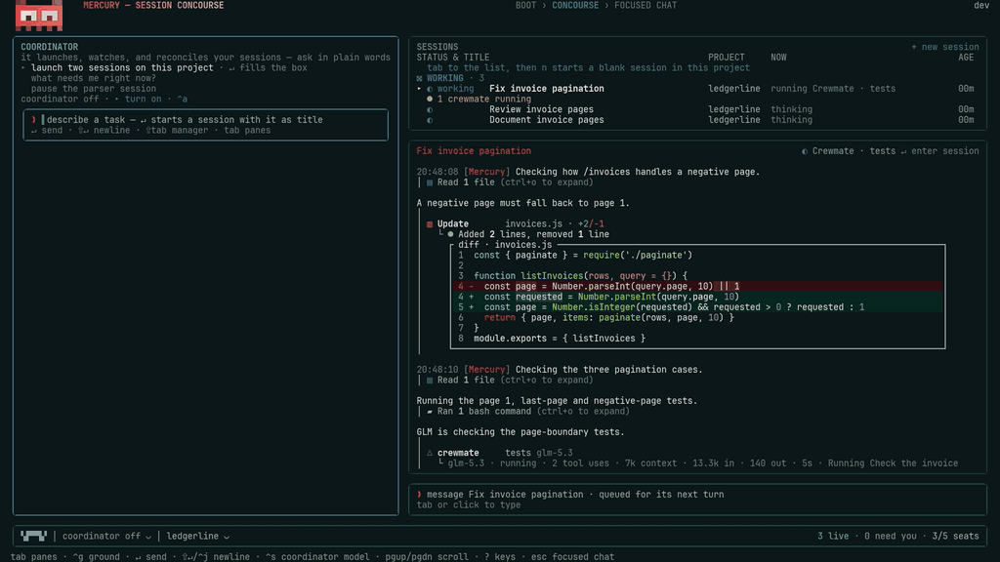

[English](../../README.md) | [简体中文](README.zh-CN.md) | [繁體中文](README.zh-TW.md) | [한국어](README.ko.md) | [Deutsch](README.de.md) | [Español](README.es.md) | [Français](README.fr.md) | [Italiano](README.it.md) | [Dansk](README.da.md) | [日本語](README.ja.md) | [Polski](README.pl.md) | [Русский](README.ru.md) | [Bosanski](README.bs.md) | [العربية](README.ar.md) | [Norsk](README.no.md) | [Português (Brasil)](README.pt-BR.md) | [ไทย](README.th.md) | [Türkçe](README.tr.md) | [Українська](README.uk.md) | [বাংলা](README.bn.md) | [Ελληνικά](README.el.md) | [Tiếng Việt](README.vi.md)

<div dir="rtl">

# Mercury CLI

Mercury CLI (mercury-cli.ai، وحزمة npm باسم `mercury-tech-cli`) يُشغّل وكلاء برمجة بالذكاء الاصطناعي في الطرفية لديك، داخل مستودعات git الخاصة بك على macOS و Linux و Windows.

الموقع: [mercury-cli.ai](https://mercury-cli.ai) · المستودع: [github.com/Whq02/MercuryCLI](https://github.com/Whq02/MercuryCLI) (`Whq02/MercuryCLI`) · npm: `mercury-tech-cli`

يقرأ الوكيل الملفات ويعدّلها، ويشغّل أوامر shell، وينتقل خطوة بخطوة عبر الاختبارات ومصحّحات الأخطاء، ويتحقق من النتائج. أنت تختار مزوّد النموذج والنموذج نفسه، وما يُسمح للوكيل بفعله:

- **Concourse متعدد الجلسات و worktrees معزولة:** شغّل عدة جلسات جنبًا إلى جنب على Session Concourse (`/concourse`)، وفوّض العمل المتوازي إلى Crewmates عبر المزوّدين (`Crewmate`) داخل نسخ `git worktree` معزولة، مع حجوزات ملفات المشروع (project file leases) حتى لا تكتب الوكلاء المتوازية فوق عمل بعضها.
- **20 مزوّدًا للنماذج، و `/llmhost` و `/localsetup`:** أبقِ المزوّدين العشرين جميعهم مسجّلين الدخول في وقت واحد (OpenAI، Anthropic، Google Gemini، DeepSeek، Moonshot/Kimi، Z.AI/GLM، OpenRouter، Hugging Face، xAI/Grok، Meta/Muse، Mistral، Nous Portal، OpenCode Zen، Qwen، MiniMax، Together AI، Cohere، Groq، Cerebras، Fireworks AI)، وبدّل بين المزوّدين والنماذج أثناء المحادثة. افتح `/llmhost` لاختيار نموذج، وفحص خيارات التكميم (quantization)، وتقسيم `conversations × context`، ومستوى التفكير، وتشغيله على وحدة GPU مستأجرة (Runpod أو Vast.ai أو Lambda)، أو على حاسوبك الخاص (`mercury host`)، أو على خادم موجود. أو شغّل `/localsetup` لتثبيت Ollama أو توصيله جنبًا إلى جنب مع LM Studio و vLLM و llama.cpp.
- **ذاكرة المشروع الهجينة RAG في Mneme:** تعتمد على نموذج تضمين دلالي BGE بحجم 118 MB يعمل على الجهاز (`bge-base-en-v1.5`)، مع ترتيب الكلمات بخوارزمية BM25 وتتبّع الاستشهادات، وقواعد مثبّتة بنصّها الحرفي، وسياق بدء يراعي الفرع الحالي، وفحوص التناقض عند الكتابة، وملاحظات تسليم الجلسات، والرسم البياني في المتصفح عبر `/memory page`.
- **أدوات المُصرِّف (Compiler) والشجرة النحوية (AST) وتصحيح DAP:** تربط ذكاء الشيفرة عبر LSP وإعادة الهيكلة المعاينة مسبقًا (`LspRead`، `LspRename`، `LspMoveSymbol`، `LspMoveFile`، `LspCodeAction`، `LspFormat`)، والبحث وإعادة الكتابة بالشجرة النحوية (AST) لـ 23 لغة عبر tree-sitter (`AstSearch`، `AstEdit`)، ومُصحّح أخطاء مدمجًا بواسطة Debug Adapter Protocol (`Debug`) (`debugpy`، `js-debug`، `lldb`، `gdb`، `dlv`) للدخول خطوة بخطوة إلى اختبارات Python و Node و Go و Rust الفاشلة، وخلايا `Eval` دائمة لـ Python و JavaScript.
- **`WebSearch` بلا مفاتيح و `WebFetch` بصيغة markdown:** يبحث عبر البحث الأصلي لدى المزوّد، ومفاتيح Brave أو Tavily، وواجهات API الرسمية (Stack Exchange و npm و PyPI و crates.io و GitHub و Hacker News و Wikipedia)، و SearXNG و DuckDuckGo (بلا مفاتيح)، ويجلب الوثائق العامة بصيغة markdown ضمن ميزانية استدعاء قدرها 38,000 حرف.
- **استخدام الحاسوب على سطح المكتب، والإدخال الصوتي عبر Whisper، وجدولة Saturn، وجسور المحررات:** يتحكم في تطبيقات سطح المكتب (`Computer`)، ويحوّل الإملاء الصوتي بالضغط للتحدث (push-to-talk) إلى نص على الجهاز عبر Whisper (`/voice`)، ويجدول جلسات متكررة أو لمرة واحدة عبر Saturn (`/saturn`)، ويتصل بـ VS Code عبر Agent Client Protocol (`mercury acp`) إلى جانب Unity و Blender و Godot و Aseprite.
- **توليد الفيديو (`Video`):** أرسل prompts وملفات المشروع المرجعية إلى مولّد MiniMax المُعدّ لديك ([docs/VIDEO.md](../VIDEO.md))، واحفظ ملف MP4 الناتج، وإطار معاينة PNG اختياريًا مدته ثانية واحدة، داخل مشروعك.

يُستخدم Mercury لبناء Mercury، إذ يشغّل جلسات ونماذج متعددة عبر المهام الطويلة. ومتابعة هذا العمل هي الجزء الصعب: ما الذي ما زال يعمل، وما الذي تغيّر، وما الذي يحتاج إلى قرار. وتكتب كل جلسة ملاحظة تسليم خاصة بها عند انتهائها، وتقرأ الجلسة التالية تلك الملاحظة مرة واحدة عند بدء التشغيل إلى جانب قواعدي المثبّتة، فتمنع تلوّث السياق بين الجلسات.



Mercury مفتوح المصدر بموجب Apache License 2.0، وكذلك حزم SDK الموجودة في [sdk/](../../sdk/) و [sdk-py/](../../sdk-py/).

## التثبيت

أرشيفات الإصدارات متاحة لأجهزة Mac بشريحة Apple silicon وأجهزة Mac بمعالج Intel، ولنظام Linux بمعماريتين: x64 و arm64، ولنظام Windows بمعماريتين: x64 و arm64. ثبّت `git` بشكل منفصل؛ إذ يتضمّن كل أرشيف Node و ripgrep، لذا لا حاجة إلى تثبيت Node منفصل.

اختر طريقة تثبيت واحدة:

<div dir="ltr">

```sh
curl -fsSL https://mercury-cli.ai/install | sh     # macOS و Linux (x64 و arm64)
irm https://mercury-cli.ai/install.ps1 | iex        # Windows (x64 و arm64)، في PowerShell 7
brew install Whq02/mercury/mercury                 # Homebrew: macOS و Linux x64
npm install -g mercury-tech-cli                    # npm؛ `bun install -g mercury-tech-cli` هي الحزمة نفسها
mise use -g npm:mercury-tech-cli                   # mise، عبر حزمة npm
```

</div>

تحتفظ عناوين التثبيت بأعداد تقريبية لطلبات السكربتات حسب المصدر وحسب اليوم بتوقيت UTC (لا تُحتسب عمليات التثبيت المكتملة)؛ ولا يخزّن العدّاد أي عنوان IP أو سلسلة user-agent أو ملف تعريف ارتباط (cookie).

افتح طرفية جديدة، أو شغّل سطر `export PATH=…` الذي تطبعه أداة تثبيت الصدفة، ثم شغّل `mercury --version` للتحقق منه، وشغّل `mercury` من داخل مستودع لبدء [أول تشغيل](#أول-تشغيل). على PowerShell في Windows، وبعد تثبيت عبر Homebrew أو npm أو bun أو mise، يعمل `mercury` في الطرفية نفسها.

<details>
<summary>مسارات التثبيت والتحديثات والتحقق من الإصدارات</summary>

### كيف تختلف طرق التثبيت

يحمّل مثبّتا shell و PowerShell أحدث إصدار لمنصتك، ويتحققان من SHA-256 الخاص به مقابل `SHA256SUMS.txt`، ثم يفكّان ضغطه ويشغّلان أمر `mercury install` الخاص بالأرشيف نفسه.

يُثبَّت Homebrew وحزمة npm كلٌّ منهما على إصدار بعينه، ويُعاد نشرهما بعد كل وسم (tag)، لذلك قد يتأخران عن أحدث إصدار. تستخدم أوامر Homebrew اسم الـ tap الكامل `Whq02/mercury/mercury` (أما `mercury` المجرّد في `homebrew-core` فهو برنامج آخر). حزمة npm، `mercury-tech-cli`، مُشغِّل يُنزّل الإصدار المثبَّت لديه، ويثبّت mise الحزمة نفسها. يُزيل `mercury install --uninstall` الإصدار المثبّت وطبقة الأمر (command shim) مع الإبقاء على إعداداتك وجلساتك (شغّل أيضًا `npm uninstall -g mercury-tech-cli` إذا ثبّتَّ مُشغِّل npm).

يُثبَّت Mercury لمستخدم الجهاز نفسه، ولا يتطلب صلاحيات المسؤول. يمكنك إعادة تشغيل أمر التثبيت بأمان.

### مسارات التثبيت

تقع إصدارات البرنامج داخل مجلد الإعدادات في `~/.mercury/versions/<version>` (وعلى Windows: `%USERPROFILE%\.mercury\versions`). يُثبَّت أمر `mercury` في `~/.local/bin` على macOS و Linux، أو في `%LOCALAPPDATA%\Mercury\bin` على Windows.

يضيف `mercury install` مجلد الأمر إلى PATH مرة واحدة: سطرًا محميًا في ملف بدء الصدفة لديك، أو مدخلًا في PATH الخاص بمستخدم Windows. تلتقط الطرفية الجديدة التغيير تلقائيًا.

### التحديثات

استخدم `mercury update` مع أي طريقة تثبيت.

بالنسبة إلى التثبيت الذي أُجري عبر مثبّت shell أو PowerShell، أو عبر `mercury install`، يُحدّث Mercury نفسه في مكانه. يتحقق `--check` من وجود تحديثات، ويعرض `--status` حالة التحديث، ويعود `--rollback` إلى الإصدار السابق الذي يبقى على القرص.

بالنسبة إلى Homebrew، يسأل قبل تشغيل `brew upgrade Whq02/mercury/mercury`. الإجابة الافتراضية هي «لا»؛ أدخل `y` للموافقة. يبثّ Mercury مخرجات الأمر مباشرةً ثم يتحقق من الإصدار المثبّت بعد ذلك. استخدم `--yes` لتخطّي السؤال في السكربتات.

يستخدم مُشغِّل npm تخطيط الإصدارات نفسه الذي تستخدمه المثبّتات، ويُحيل كل تشغيل إلى الإصدار المثبّت. لذلك يحدّث `mercury update` تثبيت npm في مكانه عبر قناة التحديث الخاصة بـ Mercury. أما `npm update -g mercury-tech-cli` فيغيّر فقط الإصدار الذي تثبّته الحزمة عند أول تشغيل لها. وينطبق الأمر نفسه عند استخدام mise.

يقرأ `--check` قائمة الإصدارات نفسها لكل طريقة تثبيت، ويخبرك كيف تحدّث تثبيتك. عند توفّر تحديث، تعرض الشاشة الرئيسية `vX.Y.Z available · mercury update` مرة واحدة في ركنها السفلي الأيمن، وتعرض المحادثة الإشعار نفسه حتى تُحدّث. اضبط `MERCURY_UPDATE_NOTICE=0` لإخفاء الاثنين.

تجلب طلبات التثبيت والتحديث قائمة الإصدارات العامة والأرشيفات بشكل مجهول، ويمكنك تشغيلها دون حساب أو token. فإذا رُفض طلب مجهول، يستشير Mercury واجهة GitHub CLI (`gh`) المسجَّل الدخول إليها.

بعد التحديث، يتحقق Mercury مما إذا كان الأمر الموجود في PATH يشير إلى التثبيت المُحدَّث. فإذا كان تثبيت آخر له الأولوية، أو كان الأمر المُحدَّث مفقودًا من PATH، يشرح المشكلة وطريقة إصلاحها. ويُبلغ `mercury health` عن المشكلة نفسها.

### التحقق من الإصدارات

قبل تفعيل إصدار، يتحقق Mercury من أرشيفه مقابل `SHA256SUMS.txt`. كما يشترط أن تكون الحمولة (payload) موقّعة بمفتاح إصدارات Mercury الموجود في قائمة الثقة المدمجة في البرنامج عند بنائه، وذلك قبل تجهيز التحديث. ويترك التوقيع المرفوض التثبيتَ النشط دون تغيير.

استخدم `--allow-unsigned` لقبول حمولة غير موقّعة. ويظل Mercury يرفض مفاتيح التوقيع المجهولة، وكتل التوقيع المشوّهة، والمحتويات المعبث بها. تُظهر نتيجة الأمر وسجلّه المحلي كليهما أنك سمحت بحمولة غير موقّعة.

أرشيفات الإصدارات موقّعة. شغّل `mercury health` لفحص توقيع الإصدار المثبّت.

يُعلَّم الأرشيف الذي لا يحمل توقيع إصدار بأنه غير موقّع. يرفضه التثبيت والتحديث ما لم تمرّر `--allow-unsigned`.

يشرح [docs/TRUST.md](../TRUST.md) نتائج التحقق وكيفية فحص الأرشيف يدويًا. ويغطي [docs/TERMINAL-RUNTIME.md](../TERMINAL-RUNTIME.md) التحقق عند بدء التشغيل.

### ملاحظات المنصات

تتوفر أرشيفات الإصدارات لكل منصة مذكورة أعلاه. أما أي جهاز آخر فيُبنى من المصدر.

تتوفر أرشيفات الإصدارات لأجهزة Intel Mac.

</details>

## المتطلبات

تتضمن أرشيفات الإصدارات Node 24 LTS. يستخدم المُشغِّل و `mercury install` و `mercury update` بيئة التشغيل المرفقة؛ و `git` هو المتطلب المنفصل الوحيد للإصدار نفسه.

للبناء من المصدر، تحتاج إلى:

- **Node 24 LTS**، ضمن النطاق المدعوم `>=24.20.0 <25`. يُثبِّت `.node-version` الإصدار الفرعي (patch) المستخدم للبناء والمُضمَّن في أرشيفات الإصدارات.
- **bun 1.3.x** للبناء، وهو غير مرفق مع الإصدارات.
- **git**. على Windows، شغّل PowerShell 7 داخل Windows Terminal أو طرفية VS Code. راجع [docs/INSTALL-WINDOWS-FROM-SOURCE.md](../INSTALL-WINDOWS-FROM-SOURCE.md).

يتضمّن الحدّ الأدنى لـ Node الإصلاح الخاص بـ nodejs/node#56645. وفي الإصدارات الأدنى من 24.20.0، تُجهَض أوامر `run` بلا واجهة التي تستدعي أداة عند الخروج على Windows.

تختار المُشغِّلات Node بهذا الترتيب: الملف التنفيذي `MERCURY_NODE` المحدَّد صراحةً، ثم بيئة التشغيل المرفقة، ثم تثبيت Node متوافق موجود في PATH. وإذا كانت بيئة التشغيل مفقودة، يُبلغ المُشغِّل عن خطأ.

### الصدفات على Windows

تتضمن أرشيفات الإصدارات محرك الصدفة المتوافق مع bash الخاص بـ Mercury (`brush`)، وعلى Windows يُشغّل أداة Bash افتراضيًا: يجد برنامج `.cmd` أو `.bat` مثل `npm` باسمه المجرّد عبر PATHEXT، ويُمرّر `%VAR%` و `^` إلى ملف الدفعات دون تغيير، ويشغّل برنامجًا يُحدَّد بمسار نسبي بعد `cd`، ويحتفظ بحالة الصدفة بين الاستدعاءات. ولا يُشترط وجود `bash.exe` من Git for Windows؛ فإذا كان مثبّتًا، فإن `MERCURY_SHELL_ENGINE=system` أو `system` في `/config` ضمن Shell engine يُشغّل أداة Bash على `bash.exe` وحده.

اقرأ صف `shell` في فحص الصحة لمعرفة الصدفة النشطة وسبب اختيارها: إما المحرك المرفق (الافتراضي على Windows، أو المُفعَّل بالتثبيت المحدَّد (pin) أو بالإعداد)، أو Git Bash عندما يكون المحرك معطّلًا أو تكون حزمته غير موجودة.

على macOS و Linux تكون الصدفة النظامية هي الافتراضية؛ اضبط `MERCURY_SHELL_ENGINE=brush`، أو اختر `brush` في `/config` ضمن Shell engine، لتشغيل أداة Bash على المحرك المرفق هناك أيضًا، مع حالة صدفة دائمة.

ويبدأ البناء من المصدر التشغيل حتى دون حزمة المحرك أو Git for Windows، لكن أداة Bash تبقى غير متاحة. وتبقى أداة PowerShell متاحة، ويشرح التشخيص `shell` كيفية استعادة دعم Bash.

## البناء من المصدر

يُبنى Mercury باستخدام bun ويعمل على Node 24 LTS. ثبّت [متطلبات البناء من المصدر](#المتطلبات)، بما فيها bun 1.3.x:

<div dir="ltr">

```sh
curl -fsSL https://bun.sh/install | bash           # macOS و Linux
powershell -c "irm bun.sh/install.ps1 | iex"       # Windows، في PowerShell 7
bun --version                                      # 1.3.x
```

</div>

ثم، داخل نسخة محلية (clone) من هذا المستودع:

<div dir="ltr">

```sh
bun run setup                      # مرة واحدة؛ bun install + الحزم المُضمَّنة (vendored packs)
bun run build.ts                   # يكتب dist/mercury.mjs و dist/manifest.json
node dist/mercury.mjs --version
node dist/mercury.mjs
node dist/mercury.mjs health --json
```

</div>

### دعم الطرفية

تحتاج الواجهة بملء الشاشة إلى TTY حقيقي، لكنها لا تفرض حدًا أدنى لحجم الطرفية. يبدأ التخطيط الكامل من 100 عمودًا و26 صفًّا؛ وتستخدم النوافذ الأصغر تخطيطًا مضغوطًا.

يستخدم Mercury ألوانًا بعمق 24 بت حين تعلن الطرفية دعمها عبر `COLORTERM=truecolor`، أو حين يتعرّف عليها بوصفها أيًّا من iTerm2 أو Ghostty أو WezTerm أو Kitty أو Windows Terminal أو VS Code. وتستخدم الطرفيات الأخرى 256 لونًا، بما في ذلك Terminal من Apple على macOS 15 والإصدارات الأقدم.

يُبلغ صف Terminal color في فحص الصحة عن العمق المكتشف والسبب. اضبط `MERCURY_TRUECOLOR=1` لطرفية تدعم الألوان الحقيقية دون أن تعلن ذلك، أو `MERCURY_TRUECOLOR=0` لفرض 256 لونًا.

### المكونات الاختيارية

يُنزّل `setup` حزم القدرات المرفقة: pyright و debugpy و js-debug وقواعد لغوية إضافية (grammars) وبيئة تشغيل Node الخاصة بالمنصة و brush. فإذا فشل تنزيل، تُتخطّى تلك الحزمة ويُبلغ البناء والأدوات المتأثرة عن المكوّن المفقود. أما تشغيل `bun install` وحده فينتج بناءً بدون هذه الحزم.

لبناء دعم الصوت، شغّل `setup` مع تثبيت Rust. يُنشئ ذلك `native/voice`. أضِف cmake لبناء `native/whisper` أيضًا. ومع تثبيت Rust، يبني `setup` كذلك إضافة برنامج تشغيل سطح المكتب (`native/desktop`) التي تعمل من خلالها أداة `Computer`. ومع تثبيت Rust، يبني `setup` أيضًا إضافة التضمين المحلي (`native/embed`، عبر `bun run scripts/vendor/build-embed.ts`) ويجلب نموذج BGE بحجم 118 MB (`bun run scripts/vendor/fetch-embed-models.ts --default`)؛ وبدون cargo تُتخطّى الحزمة ويذكر setup ذلك، ويقتصر البحث في ذاكرة Mneme على مطابقة الكلمات فقط. تحمل كل أرشيفات الإصدارات حزمة التضمين المبنية لمنصتها؛ وعلى Linux و Windows تُنفَّذ الحسابات بنواة متجهية (vectorised)، لذلك يستغرق Recall بالمعنى نحو عُشر ثانية (وبضعة أجزاء من مئة من الثانية على macOS الذي يستخدم Accelerate). وإذا كانت أدوات بناء الإضافات الأصلية ناقصة، يتخطّاه setup ويُبلغ فحص الصحة عن الإضافة المفقودة. ويُبنى محرك صدفة Windows على جهازك أيضًا، لأن المشروع الأصلي لا يوفّر ملفًا ثنائيًا لـ Windows.

راجع [الصدفات على Windows](#الصدفات-على-windows) و [docs/TERMINAL-RUNTIME.md](../TERMINAL-RUNTIME.md) للاطلاع على محرك الصدفة `brush`.

لا يكتب البناء إلا داخل `dist/`. تُحفظ الإعدادات والجلسات في `~/.mercury`، أو في المجلد المحدَّد بـ `MERCURY_CONFIG_DIR`، وتُنشأ عند أول تشغيل. على Windows، شغّل `node dist\mercury.mjs` مباشرةً.

### تثبيت بناء المصدر كأمر

ينشر `scripts/ops/deploy-runtime.sh` بناءً من شجرة مصدر نظيفة إلى مجلد جديد `<config home>/runtime/builds/<build>` ويُشير `runtime/current` إليه (`runtime/dist` هو الاسم الأقدم للرابط نفسه). ويثبّت `scripts/ops/deploy-launcher.sh` المُشغِّل في `<config home>/bin/mercury`. أضِف هذا المجلد إلى PATH؛ وفي zsh:

<div dir="ltr">

```sh
echo 'export PATH="$HOME/.mercury/bin:$PATH"' >> ~/.zshrc
```

</div>

يتوقف المُشغِّل بخطأ إذا كانت بيئة التشغيل مفقودة، ولا ينتقل إلى بناء آخر. ويتبع اختيار Node الترتيب الوارد في [المتطلبات](#المتطلبات). وبالنسبة إلى تثبيت إصدار، شغّل `mercury install` أو `mercury update`، وهما يتركان نسخ المصدر دون تغيير؛ راجع [التحديثات](#التحديثات).

[AGENTS.md](../../AGENTS.md) هو الدليل المختصر للبناء والتشغيل. ويشرح [BUILD-NOTES.md](../../BUILD-NOTES.md) البناء بتفصيل أكبر.

## أول تشغيل

في أول تشغيل تفاعلي، اختر المظهر، ثم سجّل الدخول إلى مزوّد. تعرض الشاشة معاينة لتغييرات السمة أثناء تصفّحها. الخيار الافتراضي هو True Black، والخياران الآخران هما سمة oasis الداكنة وسمة Black and white، التي لا ترسم أي لون: حبر الطرفية الخاص على أرضيتها الخاصة، كما يبدو Mercury على طرفية بلا ألوان. ويمكنك تغيير ذلك لاحقًا عبر `/appearance`.

يمكنك أيضًا اختيار «sign in later» للتجوّل دون ربط حساب. وحين يسجّل مفتاح مزوّد موجود في بيئتك الدخول إلى مزوّد بالفعل، لا تُطلب خطوة تسجيل الدخول. ثم تذكّرك خطوة Guardrails بمراجعة تعديلات Mercury وأوامره، وبأن ما يقرؤه قد يحمل تعليمات موجّهة إلى النموذج. وفي طرفية يعرف Mercury كيف يُهيّئها (Terminal.app، وعائلة VS Code، و Alacritty، و Zed)، يمكن لخطوة Terminal keys أن تُهيّئ اختصارات السطر الجديد في إعدادات الطرفية نفسها (على Terminal.app في macOS، تضبط `Option+Enter` لسطر جديد وتكتم جرس الطرفية في كل ملف تعريف، وهذا يسري بعد إعادة تشغيل Terminal.app؛ وفي عائلة VS Code و Alacritty و Zed، تكتب `Shift+Enter` لسطر جديد). وهي معطّلة ما لم تختَرها، ويُحتفظ بنسخة احتياطية.

بعد ذلك، يسألك Mercury إن كنت تثق بالمجلد الذي فتحته. ولا يُشغَّل أي شيء يطلبه إعداد مساحة العمل قبل أن تمنح هذه الثقة. وتشمل المنحة المستودع بأكمله؛ ورفضها يُنهي Mercury. راجع [docs/TRUST.md](../TRUST.md).

يفتح التشغيل التفاعلي العادي الشاشة الرئيسية. وتضم عشرة عناصر في القائمة، ولا يظهر Continue Last Session إلا بعد أن يكون لديك سجلّ جلسات:

- **New Session in \<folder\>** يبدأ جلسة جديدة في المجلد الحالي.
- **Continue Last Session** يعيد فتح أحدث محادثة لديك.
- **Boot Menu** يُهيّئ الجلسات المقبلة، بما فيها Motion و Crewmates و Workflows.
- **MCPs & Skills** يختار ما تحمّله الجلسة التالية. راجع [docs/KIT.md](../KIT.md).
- **Agents** يُنشئ الوكلاء ويُعدّلهم.
- **Health Check** يفحص التثبيت.
- **Saturn Scheduler** يجدول الجلسات. راجع [docs/SATURN.md](../SATURN.md).
- **Logins** يربط حسابات المزوّدين.
- **Session Concourse** يفتح قائمة جلسات المشروع الحالي.
- **Sessions · Projects** يتيح لك اختيار جلسة أو مستودع.

تفتح عناصر القائمة فوق الشاشة الرئيسية، ويعيدك `Esc` إلى العنصر الذي اخترته. وتفتح قائمة الجلسات شاشة منفصلة، ويمكن الوصول إليها أيضًا بـ `Shift+→`. ويأخذك وسيط prompt، أو `--continue` أو `--resume`، مباشرةً إلى المحادثة.

### Motion و Crewmates و Workflows

يتضمن قسم Performance في Boot Menu إعداد Motion: `auto` أو `full` أو `reduced` أو `off`. وهو يتحكم في الحركة أثناء الخمول داخل الواجهة، ويتوفر أيضًا في `/config`.

ضمن Agents، يحدّد المفتاحان Crewmates و Workflows ما إذا كانت الجلسات الجديدة تحصل على أدوات Crewmate و Workflow. وإيقاف المفتاح يُزيل الأداة المقابلة، ومحاولات بدء ذلك النوع من العمل تُعيد الشرح نفسه. وداخل الجلسة، يغيّر `/crewmates on|off` و `/workflows on|off` الإعداد عند حدّ الدور التالي.

## الحلقة اليومية: Session Concourse و git worktrees و Crewmates

### بدء الجلسة وعزل worktrees

اضغط `Enter` على New Session لإنشاء جلسة في المجلد الحالي بنموذجك الافتراضي. ويفتح Mercury محادثتها ويضيفها إلى قائمة الجلسات في الوقت نفسه. ويُبقي عملية جاهزة خلف القائمة لتقليل عمل بدء التشغيل.

بدء جلسة أخرى لا يوقف الجلسة السابقة. يمكنك ترك مهمة قيد التشغيل والعمل في مكان آخر. شغّل بالخيار `--worktree [name]` (أو اطلب `worktree` في المحادثة لتشغيل `EnterWorktree`) لمنح الجلسة فرعها ونسختها الخاصة من الشيفرة ضمن `.mercury/worktrees/`. ويمكن للـ Crewmates المتوازية أن تعمل أيضًا في worktrees معزولة، وأن تنسّق الملفات المشتركة عبر حجوزات ملفات المشروع؛ راجع [ما بداخله](#ما-بداخله-ذاكرة-mneme-rag-و-lsp-و-ast-بدعم-23-لغة-و-مصحح-dap-و-البحث-في-الويب-و-الجسور) و [docs/CREW.md](../CREW.md).

### العمل في المحادثة

صِف العمل بلغة بسيطة. يقرأ الوكيل الشيفرة ويعدّلها ويشغّلها ويتحقق منها ضمن وضع الصلاحيات الذي تختاره. وتظهر استدعاءات الأدوات أثناء تشغيلها، إما كبطاقات مضغوطة أو مع المخرجات الكاملة. اختر طريقة العرض في `/config` ضمن Tool output؛ ويُحفظ الإعداد للتشغيلات اللاحقة.

استخدم `/model` و `/effort` لضبط الجلسة. ويتحكم `/permissions` فيما يمكن تشغيله دون موافقة، وفيما يجب أن يطلب الإذن أولًا.

راجع التغييرات عبر `/diff`، حسب المصدر والملف والمقطع (hunk). يشغّل `! <command>` أمر shell داخل المحادثة مع متابعة حية لآخر مخرجاته. ويعرض `/runs` الصدفات والـ Crewmates قيد التشغيل (ويفتح `/tasks` اللوحة نفسها)، ويفتح `/crewmates` عرض Crew المباشر. وبين الأدوار، يحفظ `/clear` المحادثة الحالية ويفتح جلسة جديدة، ويُحوِّل `/restart` المحادثة إلى بناء Mercury المثبَّت حديثًا. ويسمّي `/title` المحادثة، ويعرض `/help` الأوامر المتاحة.

### التنقل بين الشاشات

يتنقل `Shift+←` و `Shift+→` بين الشاشات المتاحة حاليًا. يكون لدى التشغيل الجديد الشاشة الرئيسية وقائمة الجلسات. وتُضاف شاشة المحادثة عند التركيز على جلسة، وتُزال عند إغلاق آخر محادثة. وتُظهر تلميحات المفاتيح الحركات المتاحة فقط.

إغلاق كل المحادثات يعيدك إلى الشاشة الرئيسية. استخدم `--chat` للشاشة الرئيسية والمحادثة فقط، دون قائمة الجلسات. ويحفظ `--concourse-off` هذا التفضيل للتشغيلات المقبلة، ويعيده `--concourse-on` أو `/config` إلى التفعيل.

### إدارة الجلسات في Session Concourse

افتح قائمة الجلسات بـ `/concourse` أو بـ `Shift+→` من الشاشة الرئيسية. تعرض أولًا جلسات المشروع الحالي قيد التشغيل، ثم المحادثات المحفوظة غير الجارية، من الأحدث إلى الأقدم.

لكل جلسة قيد التشغيل خلية NOW تعرض نشاطها الحالي. اختر صفًّا واضغط `Enter` للعودة إلى المحادثة، بينما تستمر الجلسات الأخرى في العمل. وتبقى الجلسة التي تعطّلت في قائمة الجلسات بوصف NEEDS YOU مع السبب، حتى تُحرّرها.

يغطي [docs/SESSIONS.md](../SESSIONS.md) دورة حياة الجلسة.

## المزوّدون والنماذج: تسجيلات الدخول و `/localsetup` و `/llmhost`

استخدم `/logins` لربط مزوّد. ويفتح كتالوج تسجيل الدخول نفسه المستخدم أثناء الإعداد. أما `/accounts` فيدير فتحات المزوّدين المرتبطة بعد ذلك.

- **OpenAI:** اشتراك ChatGPT أو مفتاح API.
- **Anthropic:** اشتراك Claude، أو تسجيل الدخول إلى Console، أو مفتاح API.
- **OpenRouter:** الوصول إلى الكتالوج عبر OAuth أو مفتاح API؛ وتمنع طلبات النماذج جمع البيانات، وتشترط توفّر كل معامل (parameter) منذ البداية. ويضبط `/config → OpenRouter routing policy` خيارات الاحتياط وعدم الاحتفاظ بالبيانات (zero-data-retention)؛ اختر open لتخفيف السياسة وترك التوجيه لـ OpenRouter.
- **Google Gemini:** Sign in with Google، أو مفتاح API، أو عميل OAuth خاص بك. يُشغّل Sign in with Google النموذج Gemini ضمن حصة الخطة التي يملكها حساب Google (حساب مجاني، أو Google AI Pro، أو Google AI Ultra) عبر عميل Antigravity الخاص بـ Google: تُرسَل الـ prompt ومخططات الأدوات ونتائج الأدوات إلى نقطة Code Assist التابعة لـ Google ضمن ذلك العميل والحساب المسجّل الدخول، ويعرض `/model` قائمة النماذج التي تقدّمها Google لهذا الحساب. أما مفتاح API أو عميل OAuth الخاص بك فيُحاسب مشروع Cloud بدلًا من ذلك.
- **Hugging Face:** تسجيل الدخول برمز الجهاز (device code) أو token الخاص بـ Hub.
- **Kimi (Moonshot):** تسجيل الدخول برمز الجهاز أو مفتاح API.
- **GLM (Z.AI):** مفتاح اشتراك GLM Coding Plan أو مفتاح API عام بنظام الدفع حسب الاستخدام. يحفظ `/logins zai` أيًا منهما ويسجّل الخطة؛ ويعمل `ZAI_API_KEY` أيضًا، مع `ZAI_KEY_PLAN=coding|general` لتسمية الخطة (إن لم يُضبط، يقرأها Mercury من قائمة النماذج الخاصة بالمفتاح نفسه).
- **DeepSeek:** مفتاح API من منصة DeepSeek (`/logins deepseek`، أو `DEEPSEEK_API_KEY`).
- **xAI (Grok):** سجّل الدخول باشتراك Grok الخاص بك (SuperGrok / X Premium)، أو الصق مفتاح API عبر `/logins xai`.
- **Meta (Muse):** Sign in with Meta (اشتراك Muse Code، أو رمز جهاز في متصفحك)، أو مفتاح Model API بنظام الدفع حسب الاستخدام. يتبادل Sign in with Meta رمز الجهاز مع نقاط نهاية OIDC الخاصة بـ Meta (`https://auth.meta.com/oidc/device/authorization/` و `/oidc/device/token/`) بموجب معرّف العميل العام لـ Muse Code، ويرسل token الحساب الناتج مرة واحدة إلى `https://api.meta.ai/muse-code/key` لإصدار مفتاح API للاشتراك (وكذلك في قراءات `/usage` المحدودة لمستوى الخطة ونوافذ استخدامها)، ولا يرسل مع كل طلب نموذج سوى المفتاح الذي أُصدر إلى `https://api.meta.ai/v1`. أما مفتاح Model API الملصوق أو `MODEL_API_KEY` / `META_API_KEY` فيُحاسَب بنظام الدفع حسب الاستخدام.

- **Qwen:** مفتاح QwenCloud (Token Plan أو الدفع حسب الاستخدام) أو مفتاح Alibaba Cloud Model Studio (الدفع حسب الاستخدام أو Token Plan أو Coding Plan)، يُفحص عبر نقطة النهاية الخاصة به قبل حفظه؛ ويعرض مفتاح الخطة نماذج الخطة، وتأتي Qwen3.8 Max أولًا.
- **MiniMax:** مفتاح Open Platform أو مفتاح اشتراك M Plan.
- **Together AI** و **Cohere:** مفتاح API.
- **Groq** و **Cerebras** و **Fireworks AI:** مفتاح API؛ ويمكن أيضًا أن يأتي مفتاح أي عائلة من أمر يُسمّى في `credentials.keyCommands.<family>`.

تتصل Mistral و Nous Portal و OpenCode Zen عبر `/logins` أيضًا، ليبلغ المجموع 20 عائلة مزوّدين لتسجيل الدخول. وتعمل خوادم النماذج المحلية (Ollama و LM Studio و vLLM و llama.cpp) ونقاط النهاية المخصصة المتوافقة مع OpenAI دون تسجيل دخول لدى مزوّد. شغّل `/localsetup` لتثبيت Ollama أو تشغيله، وسحب نموذج يتناسب مع ذاكرتك، وضبط نافذة السياق الخاصة به، أو لربط خادم LM Studio أو vLLM أو llama.cpp قيد التشغيل ([docs/LOCAL-SETUP.md](../LOCAL-SETUP.md)). ويستخدم كل مزوّد بروتوكوله وبيانات اعتماده ومعالجته للأخطاء الخاصة به، ولا تنتقل الطلبات أبدًا إلى مزوّد آخر. راجع [docs/ENGINES.md](../ENGINES.md).

يعرض `/llmhost` النماذج التي يمكنك استضافتها، ويُبيّن مكان تشغيل كل نموذج الآن: على وحدة GPU مستأجرة من Runpod أو Vast.ai أو Lambda، أو على حاسوبك الخاص، أو على حاسوب SSH محفوظ (`mercury host`)، أو على خادم نماذج موجود. وتعرض صفحة كل نموذج خيارات التكميم، وكيف تتوزع ميزانية ذاكرة GPU على المحادثات المتوازية (`conversations × context`)، ومستوى التفكير الافتراضي (الذي يغيّره `/effort` لكل طلب). ويتطلب تأجير GPU تأكيدًا صريحًا لسعر الساعة، ويستمر الإعداد في الخلفية إذا أغلقت النافذة المنبثقة. وعلى Runpod يمكنك أيضًا ضبط الجودة وتقسيمات السياق والتفكير قبل التأجير أو على pod قيد التشغيل (`Tune`)، وإبقاء الأوزان على volume سريع التحميل، وضبط مراقبات المخزون كل 5 ثوانٍ. وتأجير Vast.ai و Lambda جديد في الإصدار 1.0.0-beta.40، وجرى التحقق منهما مقابل واجهات API المنشورة لدى المزوّدين باستخدام بيانات اختبار ثابتة (fixtures)، ولم تُجرَ تشغيلات تأجير حية. راجع [docs/LLM-HOST.md](../LLM-HOST.md).

تستخدم الجلسات الجديدة أحدث مزوّد رُبط لديك وأحدث نموذج متاح لذلك الحساب. وتُتخطّى النماذج التي لا يستطيع الحساب الوصول إليها. وإذا لم يكن لدى ذلك المزوّد نموذج صالح للاستخدام، يتحقق Mercury من المزوّد التالي الأحدث ربطًا. ويحدث هذا الاختيار عند بدء الجلسة؛ أما الطلب الفاشل في جلسة قائمة فيبقى مع مزوّده.

يشرح `/model` الاختيار. وتختار كلمة العائلة أحدث نموذج في تلك العائلة: `/model grok` أو `/model deepseek` أو `/model kimi` أو `/model glm`. وإذا لم يكن هناك مزوّد مرتبط، تُرشدك الشاشة الرئيسية و `/model` إلى `/logins`. ويتيح لك `/defaultprovider` أن تجعل مزوّدًا بعينه الخيار الأحدث صراحةً.

يبقى الوصول إلى المزوّدين خاضعًا لشروط المزوّد نفسه وتوفّره. ولا تحل رخصة Mercury محلّ تلك الشروط.

## سطر الأوامر بلا واجهة: `mercury run` و Docker و JSON-RPC runner

تعمل النسخة المبنية نفسها دون الواجهة التفاعلية. يسرد `node dist/mercury.mjs --help` كل العلامات (flags).

يشغّل `mercury run "<prompt>"` موجّهًا دون واجهة طرفية:

<div dir="ltr">

```sh
mercury run "Summarise this repository." --format text
mercury run "Summarise this repository." --format json
mercury run "Summarise this repository." --format rows
```

</div>

- `text` يطبع الإجابة؛ ويذهب سبب الدور الفاشل إلى stderr.
- `json` يطبع آخر صف `outcome` ككائن JSON واحد.
- `rows` يكتب كائن JSON واحدًا في كل سطر: `session`، ثم `turn` وصفوف `text` و `reasoning` و `tool_call` و `tool_result` و `step` الخاصة به، وينتهي بـ `outcome`. وللانتظارات وتقدّم الأدوات والمهام الخلفية والإشعارات صفوفها الخاصة. ويحمل كل صف `seq` و `timestamp` و `session_id`؛ وتحمل الصفوف داخل الدور رقم `turn` الخاص به أيضًا. ويرقّم `seq` تدفّق هذا التشغيل بدءًا من 1، أما `turn` فيعدّ أدوار الجلسة؛ لذلك فالتشغيل الذي يُكمل محادثة مخزّنة (`-c` و `-r` و `--fork`) يرقّم دوره بعد الأدوار الموجودة فيها، ويذكر صف `session` الخاص به المحادثةَ التي يُكملها في `resume_of`.

أنواع صفوف الإخراج، حسب حقلها `type`:

- `session`: الصف الافتتاحي: `version`، و `build` (أول اثني عشر حرفًا سداسيًا عشريًا من شجرة الشيفرة التي بُنيت منها الحزمة، كما يطبعها `mercury daemon status`؛ ويغيب إذا لم يكن هناك manifest بجوار الحزمة)، و `resume_of` (في التشغيل المُكمَل، معرّف الجلسة للمحادثة التي يُكملها؛ وهو المعرّف نفسه لـ `session_id` ما لم يكن التشغيل قد تفرّع)، و `cwd`، و `model`، و `mode`، و `tools`، و `mcp_servers`، و `commands`، و `agents`، و `skills`، و `extensions` التي تملكها الجلسة، و `tools_withheld` (يظهر عندما تحجب قاعدة رفض أداةً باسمها المجرد: تحمل كل مدخلة `tool` و `rule` و `source`).
- `turn`: دور في حالة `started` أو `waiting`، مع `turn_id` الخاص به؛ و `model` و `message_ids` وعدد `agents` عند توفره.
- `text`: كتلة نص مكتملة: `message_id` و `block` و `text`، وحقل `phase` الخاص بها (`commentary` أو `final_answer`).
- `reasoning`: كتلة استدلال مكتملة: `message_id` و `block` و `text`، أو `redacted: true`.
- `tool_call`: استدعاء أداة: `call_id` و `tool` و `input`، مع `message_id` و `block` الخاصين به.
- `tool_result`: نتيجة الاستدعاء: `call_id` و `status` (`ok` أو `error` أو `aborted` أو `refused`) و `output`. ويحصل الاستدعاء الذي صاغه النموذج على نحو معيب فيُرفض قبل التنفيذ (أداة غير معروفة، أو معاملات ليست JSON صالحًا أو لا تطابق مخطط الأداة) على زوجه أيضًا: صف `tool_call` بالمعاملات كما وصلت (`{}` إذا لم تكن كائنًا)، وصف `tool_result` بالحالة `refused` ويكون `output` فيه هو السبب؛ ويليه إشعار `notice` بالتصحيح. ولم يُنفَّذ مثل هذا الاستدعاء قط، وليس رفضًا.
- `tool_update`: تقدّم أداة قيد التشغيل: `call_id` و `tick` و `source` (`shell` أو `powershell` أو `mcp` أو `eval`)، وأيٌّ من `line` و `elapsed_s` و `lines` و `bytes` و `budget_ms` و `progress` و `total` يُبلغ عنه الاستدعاء. ويُسجَّل tick لاستدعاء shell أو PowerShell مع وصول مخرجاته (والأمر الذي لا يطبع شيئًا لا يُسجّل أي tick)، ولاستدعاء MCP عندما يُبلغ خادمه عن التقدّم، ولاستدعاء Eval أثناء تشغيل خليته؛ ولا تُسجّل أي أداة أخرى tick، ويبقى استدعاء Browser أو Crewmate صامتًا حتى تصل نتيجته.
- `step`: استدعاء نموذج واحد للخيط الرئيسي: `message_id` و `model` و `usage`، و `stop` عندما يذكر النموذج سبب توقفه.
- `outcome`: نتيجة الدور، وتُوصف أدناه.
- `close`: الملاحظة التي تُترك للجلسة التالية عند الإغلاق: `state` (`stored` أو `skipped` أو `none`)، و `note_chars`، و `usage` لاستدعاءات النموذج التي كتبتها، بحيث يبلغ مجموع usage في كل الصفوف القيمةَ الموجودة في النتيجة (outcome). وعندما يُعطى الـ prompt وسيطًا، تُطلب الملاحظة داخل الدور الأخير ويسبق `close` عنصر `outcome` لذلك الدور؛ أما مع `--input rows` فيأتي بعد آخر `outcome` عند إغلاق stdin.
- `wait`: انتظار على النموذج: `state` (`first_byte` أو `retry` أو `silence` أو `loading` أو `done`) مع الأرقام التي تحملها تلك الحالة، مثل `since_ms` و `attempt` و `of` و `delay_ms` و `reason` و `http_status`.
- `heartbeat`: أظهر تدفّق النموذج نشاطًا بعد مرور ثانية على الأقل دون حدث مُحلَّل: وصلت بايتات لم تُنتج أي صف. ولا يحمل الصف شيئًا آخر، ويأتي مرة واحدة على الأكثر كل ثانية؛ ويتوقف التكرار على شكل البث لدى المزوّد، فالتدفّق الذي لا يتوقف بين الأحداث لا يُصدر أيّ صف من هذا النوع.
- `compaction`: ضغط للسياق (compaction) في حالة `started` أو `progress` أو `ended`: `trigger` (`manual` أو `auto` أو `overflow`)، و `stage`، و `fill`، و `summary_tokens`، وعند الانتهاء `exit` (`landed` أو `cancelled` أو `failed`).
- `mode`: تغيّر وضع الصلاحيات: `mode`.
- `rate_limit`: حالة حدّ المزوّد: `status` (`allowed` أو `warning` أو `rejected`)، و `window`، و `resets_at`، و `utilization`، وحقول التجاوز.
- `task`: مهمة خلفية في حالة `started` أو `progress` أو `ended`: `task_id` و `task_type` و `description` و `usage` و `summary` و `status` (`completed` أو `failed` أو `stopped`) و `output_file` بحسب ما يصبح معروفًا.
- `notice`: `warning` أو `error` للقارئ: `text`، وحقل `code` مثل `input_refused`.
- `command_output`: مخرجات أمر شرطة مائلة لم تصل إلى النموذج قط: `command` و `text`.
- `mission_updated`: تغيّر سجلّ مهام الجلسة؛ اقرأه من جديد.
- `samples_updated`: تغيّرت عينات الجلسة؛ اقرأها من جديد.

يضيف `--partial` مع `--format rows` صفوف `block_start` و `text_delta` و `reasoning_delta` و `tool_input_delta` و `retracted`. تنتمي الدلتا (deltas) إلى `message_id` و `block`؛ ويسحب صف `retracted` دلتا تلك الرسالة. وصف النص أو الأداة المكتمل هو القيمة الكاملة.

تحمل النتيجة (outcome) الحقول `schema` و `turn_id` و `status` و `steps` و `wall_ms` و `usage` و `models` و `denials`، مع `answer` عند الاكتمال و `error` (`message` و `class` و `detail` اختياري) عند الفشل. وتُدرج `stop` و `api_ms` و `cost_usd` والمخرجات المنظَّمة المطلوبة (`structured`) و `notices` عند توفرها. و `wall_ms` هو الزمن المنقضي للدور. أما `api_ms` فهو مجموع مدد كل طلب نموذج قام به الدور (بما في ذلك إعادات المحاولة وطلبات الـ Crewmates التي عملت بالتوازي مع الخيط الرئيسي)، لذلك قد يتجاوز `wall_ms` عندما تتداخل الطلبات. و `cost_usd` هو مجموع التكلفة بالدولار للطلبات المُسعَّرة في الدور، أيًّا كانت الحالة: الطلب الذي لا يستطيع Mercury تسعيره (لا معدّل مسجّل له، ولا تكلفة مذكورة في الاستجابة) لا يضيف شيئًا إليه، ويبقى نموذجه مدرجًا في `models` دون `cost_usd` خاص به؛ ولا يغيب الحقل إلا إذا لم يُسعَّر شيء في الدور. وفي تسجيل الدخول باشتراك Claude لا تحمل طلبات Anthropic سعرًا بالدولار، فلا تحمل هذه الطلبات ولا الصف حقل `cost_usd`؛ أما usage فيبقى. ويذكر usage الحقول `input_tokens` (بما فيها الرموز المخزّنة مؤقتًا)، و `cached_input_tokens`، و `cache_write_input_tokens`، و `output_tokens`، وعند الإبلاغ عنه `reasoning_output_tokens`، مجموعةً عبر الخيط الرئيسي والـ Crewmates. ويُفصّل `models` استهلاك الرموز حسب النموذج. ولا يحسب `steps` سوى استدعاءات نموذج الوكيل الرئيسي؛ أما استدعاءات النموذج التي يُجريها الـ Crewmates فتظهر كصفوف `step` خاصة بها مُعلَّمة بـ `parent_call_id`.

تكون الحالة (status) إحدى القيم `completed` أو `blocked` أو `refused` أو `failed` أو `interrupted` أو `turn_limit` أو `budget_limit` أو `time_limit` أو `schema_unmet` أو `loop_stopped`. ويُنهي التشغيل الواقع تحت `--max-time` (بالثواني، أو `10m`، أو `1h`) بالحالة `time_limit` عند الخطوة التالية بعد انقضاء الوقت؛ أما استدعاء النموذج أو جولة الأداة الجارية فلا تُقطع. ويخرج التشغيل المكتمل برمز 0، وتخرج النتائج الأخرى برمز 1، ويخرج خطأ الاستخدام برمز 2. ويخرج SIGINT و SIGTERM برمزي 130 و143 بعد تفريغ نتيجة الدور المقطوع. ويُدرج الاستدعاء المرفوض لأداة في `denials`. وعندما يكون الرفض طلب إذن لم يُجب عنه أحد (تشغيل بلا مضيف في وضع يطلب الإذن، أو `--mode dontAsk`، أو طلب مضيف انتهت مهلته)، ولا ينجح أي استدعاء أداة لاحق في الدور، تكون حالة التشغيل `blocked`: تُحفظ الإجابة، ويذكر `error` اسم الأداة وطريقة الاستئناف (`--allowed-tools` أو وضعًا آخر لـ `--mode` أو مضيفًا يُجيب على الطلبات)، ويخرج التشغيل برمز 1. وإذا نجح استدعاء أداة لاحق في الدور نفسه، يتعافى الدور وينتهي بالحالة `completed` (برمز خروج 0) مع إشعار تحذير `notice` (`"<Tool> was not approved; the run continued with other tools."`). أما الرفض الذي أجبتَ عنه (عبر قاعدة رفض، أو hook، أو مضيف قال لا) فيترك الدور المكتمل مكتملًا. ويُنهي استدعاء `AskUserQuestion` بلا إجابة التشغيل أيضًا بالحالة `blocked` مع اقتباس السؤال في `error`؛ ويقرأ Mercury النتيجة من طلبات التشغيل المسجّلة، لا من نص الرد، لذلك فالسؤال المكتوب في الرد وحده ينتهي بالحالة `completed`. ويكون أمر الشرطة المائلة غير المعروف بالحالة `refused` مع الجملة نفسها التي تعرضها الشاشة التفاعلية (`Unknown command: /name · /help lists commands`) ويخرج برمز 1.

يتطلب `--input rows` وجود `--format rows`، ويقرأ كائن إدخال واحدًا في كل سطر:

<div dir="ltr">

```sh
printf '%s\n' '{"type":"prompt","content":"Summarise this repository."}' | mercury run --input rows --format rows
```

</div>

أنواع الإدخال هي `prompt` مع `content` (كتل نصية، أو كتل نص وصورة)، و `shell` مع `command`، و `note` مع `to` (معرّف وكيل) و `content`. ويقبل كلٌّ منها `id` اختياريًا؛ وتقبل صفوف prompt و shell أيضًا `priority` (`now` أو `next` أو `later`) و `sent_at` و `origin`. يُنتج شكل الإدخال المرفوض `notice` بالرمز `input_refused`؛ وينهي JSON المعطوب التشغيل. وتحمل هذه الصفوف الإدخال فقط؛ أما إجابات الإذن فتستخدم بروتوكول runner المذكور أدناه.

استخدم `mercury run -` أو مرّر نصًا عبر الأنبوب إلى `mercury run` لقراءة الموجّه كاملًا من stdin. وإلى جانب وسيط الـ prompt، يُلحق النص المرسل عبر الأنبوب كسياق محدّد الحدود: يُقرأ الأنبوب حتى يُغلَق أو يبقى صامتًا لمدة ثانية واحدة، فيُقرأ التدفّق المستمر حتى نهايته، ولا يُبقي الأنبوبُ المفتوح الصامت التشغيلَ معلّقًا. وبلا prompt وعند وجود طرفية على stdin، يطبع `run` تعليمات استخدامه ويخرج برمز 2.

يحدد `--mode <mode>` وضع الصلاحيات. يعمل `--sovereign` دون مطالبات الإذن، ويجعل `--allow-sovereign` هذا الوضع متاحًا للتبديل لاحقًا. وتظل سياسة الإذن وقواعد الرفض سارية. ويتلقى المستخدم root الذي يدخل وضع sovereign إشعارًا واحدًا على stderr، ويستمر التشغيل.

استخدم `-c` لمتابعة أحدث محادثة، و `-r` للاستئناف بالمعرّف أو العنوان أو المنتقي (picker)، و `-w` للتشغيل في worktree مُدارة، و `--lean` لجلسة مبسّطة. لا يملك `run` مضيفًا يجيب على طلبات الإذن: تحدد قواعد الإذن ووضعُ الصلاحيات ما يمكن تشغيله، ويُرفض أي استدعاء ما زال يحتاج إلى موافقة.

### الصورة بدون واجهة

يبني `Dockerfile` في جذر المستودع صورة Linux x64 لبيئات CI والخوادم. نقطة دخولها هي `mercury` وفعلها الافتراضي هو `run`، لذلك تُشغّل الصورة موجّهًا واحدًا على شجرة ملفات مُركّبة (mounted) وتخرج برمز تشغيل ذلك الموجّه:

<div dir="ltr">

```sh
docker build -t mercury .
docker run --rm -e ANTHROPIC_API_KEY="$ANTHROPIC_API_KEY" -v "$PWD":/work mercury run "Summarise this repository." --format text
docker run --rm mercury --version
```

</div>

تحمل الصورة الحزمة، وبيئة تشغيل Node 24 الخاصة بها (على `PATH`)، وأدوات البحث والصدفة ومصحّح الأخطاء واللغات والصور المُضمَّنة، و `git` ومخزن الشهادات؛ دون شاشة دخول وبلا تدفّق لتسجيل الدخول. تعمل الصورة بوصفها المستخدم غير الجذري `mercury` ومجلد الإعدادات الخاص بها داخل الحاوية (`MERCURY_CONFIG_DIR`)، و `/work` هو مجلد عملها. ويتبع اللون والفأرة اكتشاف الطرفية الخاص بالمنتج، ويعمل `--user 0` بصلاحيات root مع إشعار sovereign الواحد المذكور أعلاه.

يصل مفتاح المزوّد كمتغيّر بيئة، بالصيغ نفسها التي يقرؤها المنتج في كل مكان: `ANTHROPIC_API_KEY` أو `ANTHROPIC_AUTH_TOKEN`، و `OPENAI_API_KEY`، و `GEMINI_API_KEY` أو `GOOGLE_API_KEY`، و `XAI_API_KEY` (و `XAI_MANAGEMENT_API_KEY` لعدّاد استخدامه)، و `DEEPSEEK_API_KEY`، و `MOONSHOT_API_KEY`، و `ZAI_API_KEY`، و `OPENROUTER_API_KEY`، و `HF_TOKEN`، و `MISTRAL_API_KEY` (و `MISTRAL_ADMIN_API_KEY` لعدّاد المنظمة)، و `NOUS_API_KEY`، و `OPENCODE_API_KEY`، و `MINIMAX_API_KEY`، و `TOGETHER_API_KEY` أو `TOGETHER_AI_API_KEY`، و `COHERE_API_KEY` أو `CO_API_KEY`، و `GROQ_API_KEY`، و `CEREBRAS_API_KEY`، و `FIREWORKS_API_KEY`، و `DASHSCOPE_API_KEY`، و `MODEL_API_KEY` أو `META_API_KEY`، و `MERCURY_COMPAT_API_KEY` لنقطة نهاية مخصصة متوافقة مع OpenAI، و `MERCURY_LOCAL_API_KEY` لخادم محلي. وبلا مفتاح، يرفض التشغيل في سطر واحد ويخرج برمز 1. ويقرأ `docker run -i … mercury run -` الموجّه من stdin.

### استضافة جلسة

يُتيح `mercury runner` جلسةً لمضيف عبر stdio: بروتوكول JSON-RPC 2.0، رسالة واحدة في كل سطر. يُرسل المضيف `initialize` أولًا، وينتظر الإجابة قبل إرسال أي عمل:

<div dir="ltr">

```json
{"jsonrpc":"2.0","id":1,"method":"initialize","params":{"protocol":1,"host":{"name":"my-host","version":"1.0.0"},"capabilities":{"holds_asks":true,"elicitation":false,"partial_rows":false}}}
```

</div>

يحمل اسم المضيف وإصداره ضمن `host`، ويُعلن `capabilities` عن `holds_asks` و `elicitation` و `partial_rows`. ويجب أن يكون كل `id` لطلب عددًا صحيحًا موجبًا: فالطلب الذي يكون `id` فيه أي شيء آخر يُجاب عليه بالرمز `-32600` مع `id: null`، لذا فرقّم الطلبات ابتداءً من 1.

يقبل `queue/add` كائن prompt أو shell أو note نفسه المذكور في إدخال الصفوف أعلاه، ويصل الإخراج في إشعارات `row`. ويقرأ `session/facts` حالة الجلسة؛ ويغيّر `session/set_mode` وضع الصلاحيات فورًا؛ ويغيّر `session/set_model` و `session/set_effort` النموذج والجهد، وأي تغيير يُجرى أثناء تشغيل دور يُؤجَّل حتى ينتهي الدور، فيُجيب بالقيمة `at: "turn_end"`، ثم يعلن `session/applied` عنه. ويوقف `turn/interrupt` دورًا؛ أغلِق stdin لإنهاء الجلسة.

تصل طلبات الإذن كـ `permission/request`، مع `kind: "tool"` أو `kind: "network"`. ويُجيب المضيف بـ `outcome: "allow"` أو `outcome: "deny"`؛ ويمكن أن يحمل السماح `input` معدّلًا وقواعد `rules` للإذن. ويرسل الطلب المسحوب `$/cancel_request` مع `request_id` الخاص به. ويمنح `holds_asks` المضيفَ ملكية مؤقّت الطلب (clock). ويستخدم سؤال MCP الرسالة `elicitation/request` فقط عندما يُعلن المضيف `elicitation`؛ وإلا يُجاب عليه بـ `cancel`.

يُعاد الرمز `-32601` للطريقة (method) غير المعروفة، و `-32602` للمعاملات غير الصالحة، ولـ `id` ليس عددًا صحيحًا موجبًا الرمز `-32600`، و `-32002` لطلب يسبق التهيئة. ويكون رفض القاعدة بالرمز `-32010`، مع جملة في `error.message` وسبب في `error.data.kind`، مثل `mode` أو `model` أو `effort` أو `claim`. ويُجيب runner على السطر المشوّه بالرمز `-32700` ويواصل؛ وتُنهيه ثلاثة أسطر مشوّهة متتالية.

### أوامر أخرى

تشمل الأوامر المتاحة:

- **`mercury health`**: تقرير تشخيصي، ويُسمّى أيضًا شهادة الصحة (health certificate). يطبع `--json` التقرير كاملًا، ويُجري `--deep` الجرد العميق، ويُجري `--fix` الإصلاحات الموجَّهة.
- **`mercury auth login [<family>]|list|status [<family>]|logout [<family>]|mint`**: تسجيل الدخول (`login [<family>]`)، أو عرض عائلات المزوّدين (`list`)، أو التحقق مما إذا كان الحساب مسجّلًا للدخول (`status [<family>]`)، أو تسجيل الخروج (`logout [<family>]`)، أو إصدار token طويل الأمد لـ Anthropic (`mint`).
- **`mercury models [--json]`**: يطبع النماذج التي تصل إليها الحسابات المسجّلة الدخول (وهي المعطيات نفسها الواردة في `mercury://models`).
- **`mercury mcp`**: إدارة خوادم MCP بالأوامر `add` و `import` و `list` و `get` و `remove` و `trust-reset` و `serve`.
- **`mercury extensions`**: تثبيت الإضافات (extensions) وإدارة مصادرها. الإجراءات: `list` و `sources` و `add` و `remove` و `refresh` و `install` و `trust` و `enable` و `disable` و `update` و `uninstall` و `fence` و `unfence` و `inspect` و `scaffold`.
- **`mercury roster`**: يعرض جرد الوكلاء.
- **`mercury usage`**: يطبع سطر الأرقام المختصر الذي تعرضه شاشة `/usage`؛ ويطبع `--json` القراءة كاملة: نوافذ كل مزوّد مسجّل الدخول مع ما استُهلك منها وموعد إعادة ضبطها، والأرقام والأرصدة التي أعلنها، كلٌّ مع مصدره وعمره، وإنفاق الجلسة لكل نموذج، مقروءةً بالطريقة التي تقرأ بها الشاشة ذلك (إذ تُؤخذ عينة واحدة من قارئ كل مزوّد مسجّل الدخول، كما عند الفتح).
- **`mercury daemon run|status|stop|restart`**: تشغيل الخدمة الخلفية (daemon) أو فحصها أو إيقافها أو إعادة تشغيلها. ومقاعد الجلسات فيها (seats) عمليات فرعية لـ `mercury runner`؛ ويُرسل daemon الـ prompts الخاصة بها ويستضيف طلبات الإذن الخاصة بها.
- **`mercury sessions list`** (وكذلك `mercury sessions` وحدها): يعرض الجلسات المحفوظة لهذا المشروع، من الأحدث إلى الأقدم: المعرّف، وموعد آخر كتابة، وحجمها، و `live` عندما يستضيفها daemon الآن، وعنوانها أو أول prompt فيها؛ ويقرأ `--all` كل المشاريع، ويحدّ `--limit <n>` القائمة. والمعرّف هو ما يُعيد `mercury --resume <id>` فتحه، وما يحذفه `sessions delete`.
- **`mercury sessions delete <id>`**: حذف جلسة محفوظة واحدة عمدًا، أي نصّها والسجلات المحفوظة بجانبها (الإيصالات، ولقطة الاستئناف)، بعد سؤال تأكيد؛ ويتخطّى `--yes` السؤال في السكربتات. ويُرفض حذف جلسة يستضيفها daemon الآن، ويُرفض المعرّف المجهول مع تلميح يُحيل إلى الجرد (`/sessions` داخل Mercury). ولا تُحذف الجلسات المحفوظة من تلقاء نفسها أبدًا.
- **`mercury host [status|start|stop|restart|logs|uninstall|add|recipes]`**: تشغيل حاسوب محلي أو عبر SSH بوصفه خادم نماذج لكل جلسة تشارك مجلد الإعدادات (`compat/box-<name>/<model>`)، باستخدام بنك أوزان محلي موثَّق أو تنزيل مؤكَّد. راجع [docs/LLM-HOST.md](../LLM-HOST.md).
- **`mercury lsp list`** و **`mercury lsp install <server>`**: كتالوج خوادم اللغات، مع بيان كل خادم إما مثبّتًا (مع ملفه التنفيذي) أو غائبًا (مع أمر تثبيته)؛ ويعرض `install` أمر تثبيت الخادم، ويسأل، وينفّذه تمامًا (ويتخطّى `--yes` السؤال في السكربتات)، ويُبلغ عن المكان الذي استقر فيه الملف التنفيذي. ويُرفض الخادم المجهول مع عرض الجرد. ولا يثبّت Mercury خادم لغة من تلقاء نفسه أبدًا؛ إذ لا يشغّل فتح الملف إلا خادمًا مثبّتًا مسبقًا.
- **`mercury acp`**: يُقدّم محرّرًا عبر Agent Client Protocol، مع runner فرعي لكل جلسة. يثبّت `mercury bridge install` إضافة VS Code؛ ويفحصها `mercury bridge status`؛ ويزيلها `mercury bridge uninstall`.
- **`mercury godot run|check|capture|frames|profile|tour|jobs|cancel|result`**: إدارة مهام المحرّك لمشروع Godot في المجلد الحالي. ويشغّل Mercury المجموعات على عمّال بلا واجهة (headless) خاصّين به من نسخة مجمّدة من المشروع. وتشمل الخدمة بوّابة التجميع، والالتقاطات، وإحصاءات الإطارات، والملفات الشخصية المكتملة (profiles)، والوصول إلى طابور المهام، والإلغاء، والنتائج عبر المعرّف. راجع [docs/VULCAN-GODOT-TOOLS.md](../VULCAN-GODOT-TOOLS.md).
- **`mercury image <image>`**: يعرض صورة في الطرفية.
- **`mercury install`** و **`mercury update`** (الاسم المستعار `upgrade`): تثبيت أو تحديث أرشيفات الإصدارات؛ ومع `--json` يُطبع المستند على stdout مهما كانت النتيجة، ويبيّن رمز الخروج ما إذا كان الأمر قد فشل. راجع [التثبيت](#التثبيت).
- **`mercury version`** و **`mercury help [command]`**: يطبعان سطر الإصدار أو صفحة المساعدة، وهما مماثلان لـ `--version` و `--help`؛ ولا يبدأ أيٌّ منهما جلسة.

## ما بداخله: ذاكرة Mneme RAG و LSP و AST بدعم 23 لغة و مصحح DAP و البحث في الويب و الجسور

- **ذاكرة المشروع الهجينة RAG في Mneme.** تعمل Mneme افتراضيًا، فتحفظ حقائق كل مشروع في صفحات موضوعات markdown بسيطة (`Retain` و `Recall` و `Reflect` و `Correct`). ويدمج Recall نموذج تضمين دلالي BGE بحجم 118 MB يعمل على الجهاز (`bge-base-en-v1.5` بصيغة `q8_0`، وبترخيص MIT، ومُضمَّن في كل أرشيف إصدار ومبني لمنصته؛ راجع [المكونات الاختيارية](#المكونات-الاختيارية))، مع ترتيب الكلمات بـ BM25 بعد اشتقاق جذورها، وترجيح الحداثة، وتتبّع الاستشهادات عبر دمج الرتب المتبادل (reciprocal rank fusion) بقيمة `k = 60`. وتُحمَّل القواعد المثبّتة (`pin: true`) بنصّها الحرفي على رف القواعد المثبّتة، ولا تتغيّر إلا بأمرك. وعند بدء الجلسة، يُقيّم Mercury الحقائق غير المثبّتة والملاحظات السابقة مقابل فرعك الحالي، والملفات التي لُمست مؤخرًا، وملاحظة التسليم الخاصة بالجلسة الأخيرة، ضمن ميزانية بدء مخصّصة (`memory.startLimit`، والافتراضي 4,000 حرف). وتلتقط فحوص التناقض عند الكتابة قلب القطبية والنفي وتبديل الأرقام قبل حفظ حقيقة متعارضة. وتكتب كل جلسة ملاحظة تسليم بعبارتها الخاصة عند الخروج، لتكون في صفحة مدخل الجلسة التالية، إضافةً إلى مدخل اختياري في يومية الجلسة. ويفتح `/memory` مركز الذاكرة، ويرسم `/memory page` المكتبة في متصفحك رسمًا بيانيًا من العُقد والحواف. راجع [docs/MNEME.md](../MNEME.md).
- **ذكاء الشيفرة عبر LSP، وإعادة كتابة AST بـ 23 لغة، ومصحّح DAP، وخلايا `Eval`.** تتيح القراءات المرتبطة بمرساة (anchored) والتعديلات الذرية متعددة الملفات (`ChangeSet`)؛ واستعلامات خادم اللغة (`LspRead`)، وإعادات الهيكلة التي تُعاين أولًا ثم تُطبَّق (`LspRename`، `LspMoveSymbol`، `LspMoveFile`، `LspCodeAction`، `LspFormat`)؛ والبحث في الشجرة النحوية وإعادة كتابتها (`AstSearch`، `AstEdit`) مع المتغيّرات الوصفية `$NAME` و `$$$NAME` عبر 23 قاعدة لغوية في أرشيفات الإصدارات (16 في كل بناء `bun install` و7 في حزمة القواعد اللغوية)؛ وخلايا شيفرة دائمة لـ Python (`python3`) ولـ JavaScript (وحدة ES لـ Node) (`Eval`)؛ ومُصحّح يعتمد على Debug Adapter Protocol (`Debug`) ويشغّل `debugpy` و `js-debug` و `lldb` و `gdb` و `dlv` و `netcoredbg` و `rdbg` ومُحوِّل التصحيح الخاص بـ Dart SDK و `kotlin-debug-adapter` ومُحوِّل elixir-ls و Godot. وفي الأداة `Test`، يُدخلك الإجراء `debug` خطوة بخطوة إلى اختبار فاشل بلغة Python (`pytest`، `unittest`)، أو JavaScript/TypeScript (`node-test`، `vitest`، `jest`)، أو Go (`go test`)، أو Rust (`cargo test`)، مباشرةً إلى جلسة `Debug`. راجع [docs/LANGUAGE-SERVICE.md](../LANGUAGE-SERVICE.md)، و [تحويلات التغيير](../CHANGE-TRANSACTIONS.md)، و [الأنماط البنيوية](../STRUCTURAL-PATTERNS.md)، و [خلايا الشيفرة](../EVAL.md)، و [المُصحِّح](../DEBUGGER.md).
- **`WebSearch` بلا مفاتيح و `WebFetch` بصيغة markdown.** تسلك `WebSearch` سلسلةً واحدة: البحث الحي الأصلي لدى المزوّد أولًا عندما يدعمه نموذج الجلسة (`ProviderSearch`)، ثم مفاتيح Brave أو Tavily المحفوظة، ثم واجهات API الرسمية المختارة حسب شكل الاستعلام (Stack Exchange و npm و PyPI و crates.io و بحث شيفرة GitHub و Hacker News عبر Algolia و Wikipedia)، ثم واجهات SearXNG JSON المُعدّة (`MERCURY_SEARCH_SEARXNG_INSTANCES`)، وأخيرًا كشط صفحات DuckDuckGo بلا مفاتيح (مفعّل افتراضيًا؛ ويمكن إيقافه في `/config` أو عبر `MERCURY_SEARCH_KEYLESS=0`). وتبقى كل إجابة دون 2,000 token وتذكر المصدر الذي أجاب. ويقرأ `WebFetch` الصفحات العامة بصيغة markdown بعبارة الصفحة نفسها ضمن ميزانية استدعاء قدرها 38,000 حرف؛ والصفحة التي تحتاج إلى متصفح تُقرأ عبر القارئ المستضاف `r.jina.ai` ما لم يُضبط `MERCURY_FETCH_READER=0`، ولا يُرسَل إليه عنوان شبكة خاصة أبدًا. راجع [docs/ENGINES.md](../ENGINES.md).
- **الوكلاء، والـ Crewmates عبر المزوّدين (`Crewmate`)، و worktrees، وحجوزات الملفات.** يوجد وكيلان مدمجان (`mercury-crew` للعمل المفوَّض من كل نوع، و `mercury-scout` للاستطلاع للقراءة فقط) إلى جانب تعريفات الوكلاء التي تنشئها في `/agents`. أطلِق Crewmates على أي مزوّد سجّلتَ الدخول إليه، واعزل العمل المتوازي في نسخ `git worktree` (`isolation: "worktree"`)، ونسّق الملفات المشتركة عبر حجوزات ملفات المشروع داخل العملية (`mcp__mercury__lease_take` و `mcp__mercury__lease_release` و `mcp__mercury__lease_list`)، وتوجيه Crewmates واستئنافها بالاسم أو المعرّف عبر `SendMessage` و `ResumeCrewmate`. تابِع Crewmates وتشغيلات سير العمل في `/crewmates` و `/runs`. راجع [docs/CREW.md](../CREW.md).
- **استخدام الحاسوب على سطح المكتب.** مفعّل افتراضيًا عندما يكون برنامج التشغيل الأصلي لسطح المكتب متاحًا. تلتقط أداة `Computer` لقطات الشاشة، وتتحكم في الفأرة ولوحة المفاتيح داخل التطبيق الذي في المقدمة. ويتحقق Mercury من التطبيق بالاسم والهوية قبل أن يتصرف، ويطلب الموافقة ما لم تسمح بالإجراء قواعد الإذن لديك، أو منحة الجلسة، أو إعداد الوصول، أو وضع الصلاحيات؛ ويتوقف عند `Esc`، ويسمح لجلسة واحدة فقط بالتحكم في سطح المكتب في وقت واحد، ويُبقي لقطات الشاشة خارج ملف المحادثة المحفوظ. اضبط `MERCURY_COMPUTER_USE=0` لإزالة الأداة. راجع [docs/COMPUTER-USE.md](../COMPUTER-USE.md).
- **إدخال صوتي عبر Whisper على الجهاز (`/voice`).** يُنزّل `/voice on` نموذج الكلام الإنجليزي بحجم 60 MB (`base.en-q5_1`) عند أول استخدام، ويتحقق من بصمته SHA-256، ويفعّل الإملاء؛ أما `/voice off` فيعطّله. أمسِك مفتاح المسافة لمدة ثانية للتحدث، وأفلِته للتوقف، أو شغّل `/voice` وحدها لبدء التسجيل وإيقافه بينما الصوت مفعّل. ويحوّل Whisper الصوت إلى نص على الجهاز، فلا يغادر صوتك الجهاز أبدًا، ويختار `MERCURY_WHISPER_MODEL` النموذج `tiny.en-q5_1` أو `small.en-q5_1` أو النموذج متعدد اللغات `base-q5_1` أو ملف `.gguf` محلي. راجع [docs/VOICE.md](../VOICE.md).
- **جدولة Saturn (cron) وجدولة الجلسات (`/saturn`).** جدوِل prompt لجلسة موجودة (`CronCreate` و `CronList` و `CronDelete` و `ScheduleWakeup` و `/loop`)، أو جدوِل جلسة جديدة لتبدأ في وقت محدد. ويمكن أن تعمل الجداول مرة واحدة أو أن تتكرر. راجع [docs/SATURN.md](../SATURN.md).
- **جسور VS Code (ACP) و Unity و Blender و Godot و Aseprite.** يتصل `mercury acp` بالمحررات التي تدعم Agent Client Protocol. وتشغّل إضافة VS Code (`mercury bridge install`) Mercury داخل المحرّر عبر هذا البروتوكول: المحادثة، والجلسات، والوكلاء، والمخرجات (artifacts)، والمراجعات، مع تحديد المحرّر وتشخيصاته مرفقةً بكل prompt. وتتصل تكاملات منفصلة تفعَّل عند الطلب بمحررات Unity (`MERCURY_UNITY=1`) و Blender (`MERCURY_BLENDER=1`) و Godot (`MERCURY_GODOT_TOOLS=1`) التي تعمل، مع وصول دفعي إلى Aseprite (`MERCURY_ASEPRITE=1`). راجع [Unity](../UNITY-BRIDGE.md) و [Blender](../BLENDER-BRIDGE.md) و [Godot](../VULCAN-GODOT-TOOLS.md) و [Aseprite](../ASEPRITE-BRIDGE.md).
- **الإضافات (Extensions).** لكل إضافة بيان واحد (manifest). أضِف المصادر من عنوان git أو مجلد محلي أو أرشيف، معتمدةً بتجزئة مساهماتها (contributions hash). راجع [docs/EXTENSIONS.md](../EXTENSIONS.md).
- **MCPs & Skills.** إعدادات لكل مستودع تحدد ما تحمّله الجلسات، مع إعدادات مسبقة مسمّاة وضوابط يمكنك تغييرها أثناء الجلسة. راجع [docs/KIT.md](../KIT.md).
- **التشخيصات.** ينتج فحص الصحة و `/health` تقريرًا مدعومًا بأدلة تشخيصية، مع حكم `certified` أو `caution` أو `fault`، وإصلاحات مُتحقَّق منها. راجع [docs/HEALTH-CERTIFICATE.md](../HEALTH-CERTIFICATE.md).
- **الثقة والصلاحيات.** ثقة مساحة العمل، وقواعد الإذن وأوضاعه، والأوامر التي ترفضها كل جلسة. راجع [docs/TRUST.md](../TRUST.md).
- **Apollo Mode**، وهو مقابلة المواصفات: أجب عن أسئلة الوكيل لإكمال المواصفات التي سيستخدمها لبناء نموذج أولي (prototype). راجع [docs/APOLLO-MODE.md](../APOLLO-MODE.md).
- **الاسترداد.** نشر ذرّي، وعمليات مُسجَّلة في يومية، ومطابقة عند بدء التشغيل. راجع [docs/DURABILITY.md](../DURABILITY.md).

تُعرَّف أعلام التشغيل في `src/substrate/flagRegistry.ts`، وتُعرض كإعدادات `MERCURY_*`، وتُولَّد عند الطلب. وتُوثَّق توافقية التكاملات في [docs/COMPATIBILITY.md](../COMPATIBILITY.md). وفهرس التوثيق الكامل هو [docs/README.md](../README.md).

## أوامر الشرطة المائلة

يعرض `/help` أوامر التفاعل المتاحة. استخدم `/palette` للبحث الضبابي (fuzzy) في الأوامر. يجمع الجدول أدناه الأوامر المدمجة المفعّلة افتراضيًا حسب الفئات المستخدمة في `/help`؛ وتتضمن القائمة الحية أيضًا `/samples` ضمن `current work` عندما تكون Samples مفعّلة (`MERCURY_SAMPLES=1` أو صف Samples في Boot Menu)، و `/showcase` عندما يكون `MERCURY_DEV_SURFACES=1` مضبوطًا، وأي مهارات (skills) أو أوامر إضافات.

| الفئة | الأوامر |
| --- | --- |
| current work | `/run` `/runs` `/workbench` `/diff` `/mission` |
| crew & delegation | `/agents` `/crewmates` `/crew` `/workflows` `/daemon` `/saturn` `/seats` `/kill` `/unkill` |
| session & context | `/clear` `/compact` `/context` `/rewind` `/sessions` `/concourse` `/rename` `/title` `/contract` `/export` `/copy` `/usage` `/realms` `/restart` |
| memory & goals | `/memory` `/console` |
| model & effort | `/model` `/effort` `/submodels` `/advise` `/caching` |
| git & review | `/review` `/audit` |
| health & introspection | `/health` `/verify` `/trace` `/capabilities` `/lsp` |
| config & setup | `/config` `/jev` `/localsetup` `/llmhost` `/permissions` `/hooks` `/mcp` `/extensions` `/skills` `/browser` `/orient` `/keybindings` `/keys` `/vim` `/mouse` `/keysetup` `/bootmenu` `/voice` |
| appearance & cockpit | `/appearance` `/critter` `/palette` `/zen` `/browse` |
| account & app | `/logins` `/logout` `/accounts` `/defaultprovider` `/update-notes` `/feedback` `/help` `/exit` |

| الأمر | وظيفته |
| --- | --- |
| `/llmhost` | اختر نموذجًا لتأجيره على Runpod أو Vast.ai أو Lambda، أو لتشغيله على حاسوبك، أو لربط خادم موجود. |
| `/restart` | انقل هذه المحادثة إلى بناء Mercury المثبَّت؛ وتتوقف المراقبات (watches) والصدفات الخلفية الجارية. |
| `/mcp` | افحص الخوادم، وسجّل الدخول، وتصفّح أدوات كل خادم ومعاملاته، وأعد الاتصال، أو بدّل حالة خادم لهذه المحادثة. |

يعيد `/mouse off` المؤشر إلى الطرفية لتحديد النص ونسخه بالطريقة الأصلية. ويُحفظ التفضيل ويظهر في `/config` باسم Mouse capture.

يبدأ الوسيط المطلوب بـ `<…>` في طريقة استخدام المهارة (skill). فمثلًا يحتاج `/update-config` و `/debug` إلى وسيط. أرسل الأمر وحده فتحصل على وصفه وطريقة استخدامه، ولا يبدأ أي دور. واختره في الإكمال التلقائي (typeahead) ثم اضغط Enter فيترك لك `/name ` جاهزًا لإضافة الوسيط. أما `/loop` فلا يحتاج إلى وسيط مطلوب ويعمل فورًا.

## الإبلاغ عن مشكلة

لتقرير قصير، استخدم [نموذج المختبِرين](https://mercury-cli.ai/report) أو `/bug --short <what you tried>` داخل Mercury. يسأل النموذج عن نظام التشغيل لديك، وعمّا جرّبته، وعمّا تعطّل؛ ولا حاجة إلى تفريغ لفحص الصحة.

شغّل `/bug <what happened>` داخل Mercury لمعاينة تقرير قبل إرساله عبر GitHub CLI (`gh`) المسجَّل الدخول إليه. ومن دون `gh`، يحفظ Mercury مسودة محلية ضمن مجلد الإعدادات، ويرشدك إلى صفحة المشكلات (issues) في المستودع.

يمكنك أيضًا فتح مشكلة مباشرةً باستخدام قالب الخطأ، أو قالب المزوّد/النموذج، أو قالب طلب الميزة. أرفِق مخرجات `--version` ونظام التشغيل والطرفية والخطوات الدقيقة. وتحتاج تقارير الأخطاء والمزوّدين أيضًا إلى `mercury health --json`، أو `node dist/mercury.mjs health --json` في حالة البناء من المصدر. ويفيد تفريغ نصي للشاشة التي ظهر فيها الخطأ.

أبلِغ عن مشكلات الأمان بشكل خاص عبر تبويب Security في المستودع، وأبقِها خارج المشكلات العامة. راجع [SECURITY.md](../../SECURITY.md). ويغطي [CONTRIBUTING.md](../../CONTRIBUTING.md) المشكلات وطلبات السحب والفحوص.

## الترخيص

تُرخَّص Mercury CLI بموجب Apache License 2.0 (`Apache-2.0`) الواردة في [LICENSE.md](../../LICENSE.md). وتُرخَّص حزمتا SDK للغتي TypeScript و Python الموجودتان في [sdk/](../../sdk/) و [sdk-py/](../../sdk-py/) (`mercury-cli-sdk` على npm و PyPI) كذلك بموجب Apache License 2.0 (`Apache-2.0`)، كلٌّ منهما بموجب ملف LICENSE الذي يحمله ([sdk/LICENSE](../../sdk/LICENSE) و [sdk-py/LICENSE](../../sdk-py/LICENSE)).

يخضع استخدام اسم Mercury وعلاماته لـ [سياسة العلامات التجارية](../../TRADEMARKS.md). وتُدرج تراخيص الأطراف الثالثة المرفقة في [THIRD_PARTY_NOTICES.md](../../THIRD_PARTY_NOTICES.md).

</div>
